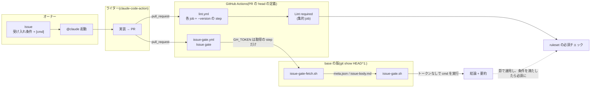

# ソフトウェア工場の独立検証ゲート(Phase 3-0〜3-1)

*   **Author:** tanimon
*   **Status:** Proposed
*   **Date:** 2026-11-15

--------------------------------------------------------------------------------

## Overview

このリポジトリでは、「GitHub Issue を渡すと、CI が通った PR が返ってくる」工場を試作している。

- **ライター:** GitHub Actions 上の `@claude`(claude-code-action)。PR の自動作成までは人の手なしで動く。
- **今いちばん大きな人の手:** ライターの PR が Issue の受け入れ条件を本当に満たしているかの検証。これはオーナーと、オーナーが使う別のエージェント「もち」が手作業で担っている。

この設計は、その検証の一部を、ライターが自分の判断で変えられない自動のゲートに移す。範囲は 2 段で、順に積む。

1. **Phase 3-0(床と物差し)**: ライターの PR を止められる必須チェック(床。最低限の線)を用意し、ライターが実際に何をできるかを実測する。あわせて、ゲートの効き目を測るための再生ケース(物差し)を凍結する。
2. **Phase 3-1([cmd] ゲート)**: Issue 本文に書いた機械検証のコマンド([cmd])を、ライターと別の job が再実行し、結果を PR に返す。最初は「影」(必須チェックにせず、結果だけを出す運用)で回す。

この設計に至るまでの検討(ブリーフと再レビュー)は、作業中の成果物として `.dev/egm/` に置いてあり、main には入れない。この設計書は、それを開かなくても読めるように書いている。

## The Problem

試運転で、ライターの PR に 2 種類の誤りが実際に残った。

*   **#621 型(機械的に拾える漏れ)**: 受け入れ条件に「削除した文書のパスを `git grep` して参照元が 0 件」とあったのに、参照が残った。条件のコマンドを誰かがもう一度実行すれば捕まる種類の誤りで、実際に手作業の再実行が捕まえた。
*   **#465 型(テストがライターの解釈をなぞる)**: ライターは自分でテストを書き、それが全部通った。しかしテストはライター自身の解釈を確かめているだけで、Issue の意図とずれた振る舞いを見逃した。人のレビューが追加したテスト 14 件のうち 8 件が、ライターの実装で失敗した。

もう 1 つ、まだ起きていないが、起きると検出しにくい誤りがある。

*   **報酬ハッキング**: ライターがテスト・CI の定義・ゲートを書き換えて、チェックを緑にする。

今のリポジトリには、これらを止める仕組みが無い。2026-11-15 時点で確認した事実は次のとおり。

*   main の ruleset で必須のステータスチェックは `Guarded paths` だけで、必要な承認数は 0。
*   `Guarded paths` の判定(`scripts/check-guarded-paths.sh`)は、自己改善ループの PR(ブランチ名が `harness/review-` で始まるもの)だけを対象にする。ライターの PR は何もせずに通す。
*   lint と bats の job(`.github/workflows/lint.yml`)は必須ではない。しかも `pull_request` トリガーなので PR の head 側の定義で実行され、ライターの PR がその定義を書き換えられる。
*   `justfile` の 4 つのレシピ(shellcheck・shfmt・actionlint・zizmor)は、ツールが無いと警告を出して成功扱いになる。ただし CI では、setup-lint の「Check mise tools」が、選んだツールが無ければ落とす。fail-open になるのは、手元とライターのセッションだけである。

検証が人の手作業である限り、工場の流量(見込みで月 20〜50 件)は、オーナーとエージェントの確認の手間で頭打ちになる。また、手作業の検証は「何を確かめたか」が記録に残らない。そのため、ゲートを強めたり自動マージに近づけたりするための判断材料が溜まらない。

この設計の提案は、次の 3 点にまとめられる。

*   必須チェックの床を先に作り、ライターの実効権限を実測で確かめる。
*   #621 型は、オーナーが Issue に書いた [cmd] を、ライターと別の job で再実行して止める。
*   #465 型は、「Issue だけから書いた独立テストが、ライターの誤った実装で赤になるか」を実験で確かめてから対策を決める。その実験は、この設計の外で別の文書として扱う。

報酬ハッキングについては、当面は「防ぐ」のではなく、「オーナーがマージの時点で見て気づける」状態を目標にする。防ぐための外部の信頼ゾーン(非公開のゲート用リポジトリや専用の GitHub App)は、自動マージを検討する段階まで持ち越す。

## Goals

*   **G1: ライターの PR を止める必須チェックがある。** lint と bats の CI 用の集合(`lint:` の依存から、local-only のレシピを除いたもの)をまとめた集約 job が、main の ruleset で必須になっている。ツールの欠けは、setup-lint の「Check mise tools」と、shfmt・actionlint・zizmor・composite-actions の job の `--version` の step が落とす。
*   **G2: ライターの実効権限が分かっている。** ライターのトークンで次の 6 つができるかを実測し、記録している。
    *   PR のマージと、ruleset の bypass
    *   オーナーの Issue 本文の編集
    *   `.github/workflows/` への push
    *   Issue の編集履歴の版の削除
    *   main の ruleset の変更
    *   `replay/*` のタグの push と削除

    マージできる場合は、main の必要な承認数が 1 になり、`require_last_push_approval` が有効で、オーナーの PR は ruleset の bypass でマージできる。
*   **G3: #621 型を止める。** ライターの PR について、紐づく Issue の [cmd] をゲートが再実行する。再生では、次の 3 つのコミットを使う。
    *   B: ライターの PR の base
    *   W: ライターの誤った head(参照が残っていた時点)
    *   F: 修正後に main へマージされたコミット

    #621 の W を再生するとゲートが赤になり、F では緑になる。
*   **G4: ライター(claude[bot])の PR では、ゲートが黙って緑にならない。** 次のどれかに当たると赤になる。
    *   紐づく Issue が 1 件でない
    *   その Issue が open でない、または別のリポジトリにある
    *   PR の head ブランチ名の Issue 番号が、紐づく Issue と一致しない
    *   Issue の作成者か本文の編集者が、信頼する login でない
    *   Issue を読めない

    出所の確認に通ったうえで Issue に [cmd] が無い場合は、理由を要約に出したうえで N/A にする(ライターが Issue 本文から [cmd] を消しても、編集者の検査で赤になる)。差分に依存する [cmd] で対象が 0 件の場合は、[cmd] の書き方の規則(対象が空なら終了コード 1)で担保し、ゲート自体は検査しない。紐づく Issue が無いローカル経路の PR は N/A で通る。これは既知の穴である(Non-Goals)。
*   **G5: マージ時に、オーナーが改ざんに気づける。** ゲートの結果の要約に、次が出る。
    *   読んだ Issue の番号とタイトル、その作成者と最終編集者
    *   実行したコマンドの全文と終了コード
    *   base と head の SHA、bash と git の版
    *   ゲート関連ファイルに触れているかの警告
*   **G6: ゲートが誤って赤にならない。** 影の期間に、[cmd] を実行したライターの実際の PR が累計 5 件(N/A は数えない)に達するまで、誤った赤が 0 件であり、その要約をオーナーが確かめた。誤った赤は、オーナーが受け入れ条件を満たしていると判断した PR で、ゲートが赤になったもの。これを満たしてから必須チェックに上げる(「影から必須へ」)。

## Non-Goals

*   **ライターが報酬ハッキングをできないようにすること。** 非公開のゲート用リポジトリ、専用の GitHub App、ゲートの定義を対象リポジトリの外へ出すことは扱わない。自動マージの検討を始めたとき、または報酬ハッキングを初めて観測したときに検討し直す。
*   **自動マージ。** マージは引き続き全件オーナーが判断する。昇格基準(連続何件の成功で自動マージにするか)も決めない。
*   **定性的な受け入れ条件([judge])の自動判定。** 別系統のモデルによるレビューは扱わない。
*   **独立テスト(#465 型への対策)。** 実験も、ゲートへの組み込みも、この設計の範囲外。実験は別の文書で計画する(Future Improvements)。
*   **Cloudflare の spike。** 並行トラックで扱い、この設計書の範囲には入れない。spike は、この設計で作るゲートのスクリプトを、同じ入力で走らせる形で別に扱う。
*   **IaC のコンテナイメージ。** Phase 3 では作らない。既存の `.github/actions/setup-lint` で CI 用の集合が通ることを前提にする。
*   **ライターのセッションでの lint の網羅。** ライターが自分で lint を全件確かめられるようにする作業(claude.yml の setup-lint の input)は、独立検証とは別のトラックで扱う。
*   **本格的な holdout(過去の Issue 20〜50 件のゴールデンセット)の構築。** この設計の再生ケースは #621 の 1 件だけ。
*   **ローカル経路への対応。** ローカル経路は、nono(Claude Code を閉じ込めるサンドボックス)の中から `claude -p` を回す経路である。ゲートは、[cmd] のある Issue に紐づく PR に限って、PR を作った経路に依存せずに動く。紐づく Issue が無いローカル経路の PR は N/A で通る。ローカル経路の PR で動くことの確認も、範囲の外。
*   **ロードマップの文書そのものの更新。** ロードマップはこのリポジトリの外にある。

## Open Questions

答えが出たら消す。

*   **Q1: ライターの `gh` の許可を、必要なサブコマンドだけに絞るか。** G2 の実測の結果で判断する。
*   **Q2: `docs/designs/` を ADR 0025 の例外にするために決めること。** この設計書は main に置く(設計判断の「設計書の置き場所」)。そのために、次を決める。
    *   ADR 0025 を改めるか、新しい ADR を書くか。
    *   ADR 0025 が挙げた「溜まる」問題への答え。たとえば、SITEMAP の Status が Superseded になった設計書を消す、drift report をどの段で誰が回すか、など。
    *   設計書と ADR のどちらを決定の正本にするか。ADR には決定と理由の要約だけを書き、詳細は設計書を参照する、など。
    *   ADR 0025 の、まだ実装していない置き場所の検査の対象から、`docs/designs/` を外す。

## Critical User Journeys (CUJs)

### CUJ 1: ライターの PR を、Issue の [cmd] で検査する

*   **Given**: オーナーが Issue に受け入れ条件を書き、機械で検査できるものを [cmd] ブロックにした。オーナーが Issue で `@claude` を起動した。
*   **When**: claude[bot] がその Issue を `Closes` で参照する PR を作る、または PR に push する。
*   **Then**: `Issue gate` の job が、次を行う。
    1.  紐づく Issue を 1 件だけ特定する。
    2.  Issue が open で同じリポジトリにあり、ブランチ名の番号と一致することを確かめる。
    3.  出所(Issue の作成者と編集者)を確かめる。
    4.  [cmd] を、base の版のゲートスクリプトで実行する。

    全部が終了コード 0 なら緑、1 つでも非 0 なら赤になる。要約に、Issue の番号・タイトル・作成者・最終編集者、各コマンドの終了コード、SHA、ツールの版が出る。

### CUJ 2: ライターが Issue を紐づけ忘れる、または取り違える

*   **Given**: claude[bot] が PR を作った。
*   **When**: PR 本文に `Closes` が無い、2 件以上の Issue を閉じる、または紐づく Issue の番号が head ブランチ名(`claude/issue-<N>-…`)の N と一致しない。
*   **Then**: `Issue gate` は赤になり、要約に理由が出る。何も検査せずに緑になることは無い。

### CUJ 3: Issue 本文がオーナー以外に編集されている

*   **Given**: ライターの PR に紐づく Issue の本文を、オーナー以外(ライターを含む)が一度でも編集した。
*   **When**: `Issue gate` が走る。
*   **Then**: 編集の内容にかかわらず赤になり、要約に編集者と時刻が出る。オーナーは編集履歴を確かめ、内容を直した新しい Issue を作って `@claude` を起動し直し、元の PR は閉じる。PR の `Closes` を付け替えるだけでは、head ブランチ名の Issue 番号(元の Issue)と一致しないので、ゲートは赤のまま残る。やり直しには、ライターの実行 1 件分の時間と利用枠がかかる。この運用は、ライターが Issue 本文を編集することがまれな場合に限って成り立つ。その前提は、G2 の実測と影の期間の観測で確かめる。

### CUJ 4: オーナーの名前で作られた PR を検査する

*   **Given**: ローカル経路など、オーナーの認証情報で PR が作られた。
*   **When**: PR が [cmd] のある Issue に紐づく。
*   **Then**: claude[bot] の PR と同じく [cmd] を実行する。Issue に紐づかない、または [cmd] が無ければ「N/A」として緑になり、要約に N/A の理由が出る。

### CUJ 5: ゲート自体の回帰を確かめる

*   **Given**: #621 の B・W・F が、`replay/621-*` のタグと、再生テストの中の定数で凍結されている。
*   **When**: ゲートのスクリプトを変える PR が出る、または lint の CI が走る。
*   **Then**: 再生のテストが、W で赤、F で緑になることを確かめる。ゲートが #621 型を捕まえなくなる変更は、このテストで落ちる。

## Technical Plan (Architecture)

### 全体の構成



信頼の境界は次のとおり。この設計は「防ぐ」ではなく「見える」を目標にしているので、境界の多くは「書き換えは可能だが、差分か要約に出る」にとどまる。

| 部品 | 定義の出どころ | ライターが書き換えたとき |
| --- | --- | --- |
| lint.yml・issue-gate.yml・claude.yml | PR の head | 書き換えられる。PR の差分にだけ出る。workflow を書き換えて呼び出しごと外すと、ゲートの要約も警告も出ない。マージ時のチェックリストで、オーナーが差分を見て気づく |
| ゲートのスクリプト(`scripts/issue-gate*.sh`) | base(`git show HEAD^1:`) | その PR の判定には効かない。ただし workflow から呼び出しを外せば効かなくなる。それは差分に出る |
| justfile・setup-lint・テスト | PR の head | 書き換えられる。差分に出る。[cmd] はこれらを呼ばない規約なので、ゲートの判定には効かない |
| Issue 本文 | GitHub の Issue | 書き換えると、編集者の検査で赤になる |
| main の ruleset | リポジトリ設定 | ライターのトークンで変えられるかは、G2 で実測する |

### 設計判断

*   **fail-closed**: CI でツールが欠けたときに落とすのは、setup-lint の「Check mise tools」に任せる(選んだツールが `mise.toml` の版に解決されなければ `exit 1` する)。そのうえで、shfmt・actionlint・zizmor の job に `run: <tool> --version` の step を 1 行ずつ足す。将来 setup-lint の input を外したときの後退を、これで捕まえる。`composite-actions` の job の `shellcheck --version` と同じ形である。justfile と bats には手を入れないので、手元とライターのセッションは fail-open のまま残る。必須チェックは CI の側にある。
*   **lint は [cmd] に書かない**: 「`just lint` が通る」は、集約 job `Lint required` の必須チェックが担う。[cmd] には、その Issue に固有の検査だけを書く。
*   **[cmd] は runner の標準ツールだけを使う**: [cmd] は bash・git・grep・jq など、runner に標準で入っているものだけを使う。リポジトリのスクリプト・just・pnpm は呼ばない。head 側のコードを実行しないので、ゲートの job に setup-lint は要らない。また、head のコードが要約を偽る経路も、規約の範囲では無くなる。これは規約であって強制ではない(Risks & Mitigations)。
*   **対象の PR**: 作成者を問わず、[cmd] のある Issue に紐づく PR ではゲートを実行する。作成者がライターの PR は、紐づく Issue が 1 件以外のとき、紐づけの確認に落ちたとき、出所の確認に落ちたときに赤にする。ライターの PR では、出所の確認を [cmd] の有無より先に、常に行う。ライターが Issue 本文から [cmd] を消して N/A を得る経路を、編集者の検査で塞ぐためである。それ以外の PR では、出所の確認は Issue に [cmd] があるときだけ行う(第三者が作った Issue を人の PR が閉じる、通常の使い方を赤にしないため)。出所の確認を通った後に Issue に [cmd] が無ければ、作成者を問わず N/A とし、理由を要約に出す。[cmd] が無い Issue で赤にすると、受け入れ条件が [test] と [judge] だけの Issue では、中身の無い [cmd] を書くしか回避の手段が無くなるからである。
*   **出所と紐づけの確認**: 信頼する login は、PR のリポジトリの owner とする(`meta.json` の `repository` の owner 部分。`github.repository_owner` と同じ値だが、env ではなく meta から取る)。ライターは GraphQL で login が `claude` かつ `__typename` が `Bot` の作成者に固定する。ライターの PR は、head ブランチ名 `claude/issue-<N>-…` の N が紐づく Issue と一致することを求める。`@claude` の起動コメントは検査しない。過去の工場の Issue はどれも起動コメントを持つので、紐づけ替えを防げないからである。
*   **実装の担い手**: この設計の実装 PR は、オーナーの手元のセッションが書く。ライターには書かせない。自分を検査するゲートを、ライター自身に書かせないためである。PR 1 の試運転(実効権限の実測)だけは、ライターに走らせる。
*   **設計書の置き場所**: この設計書は `docs/designs/` に置いて main に入れ、`docs/designs/SITEMAP.md` に登録する。ADR 0025 は Working Document をマージ前に消すと決めているが、`docs/designs/` はその例外にする。EGM(この設計書を作った手順)は、設計書を main に置き、drift report でコードとのずれを点検する前提だからである。例外にするために決めることは Q2 にある。

### Phase 3-0: 床と物差し

#### 1. ライターの実効権限の実測(G2)

試運転用の Issue で `@claude` を起動し、使い捨ての Issue・ブランチ・PR に対して次を試させる。ライターのセッションには `Bash(gh *)`(gh を自由に呼べる許可)があるので、セッションのトークンそのもので試せる。

| 試す操作 | コマンドの例 | 結果の扱い |
| --- | --- | --- |
| PR のマージ | `gh pr merge <使い捨ての PR>`。PR は main 向けで、変更は `docs/research/merge-probe.md` を 1 行足すだけにする(`docs/` は `.chezmoiignore` で除外されているので、マージされても `chezmoi apply` は何も配置しない) | できたら、オーナーが revert の PR でファイルを消す。そのうえで、その時点で(PR 1 のマージ前に)次の 2 つを行う。<br>1. main の ruleset の必要な承認数を 1 にし、`require_last_push_approval` を有効にする。<br>2. bypass にリポジトリの admin ロールを入れ、オーナーの PR は bypass でマージする。 |
| ruleset の bypass | `gh pr merge --admin <使い捨ての PR>`。承認数を 1 にした後に試す(承認数が 0 のうちは、何も止めないので確かめたことにならない)。マージの成否にかかわらず行う | できれば、承認数 1 の緩和策がライターに効かない。トークンの権限を絞る(Q1)まで、Risks の該当する行を見直す |
| main の ruleset の変更 | `gh api repos/{o}/{r}/rulesets/<id>` で取得した本文を、変えずにそのまま `-X PUT` で書き戻す(権限だけを確かめ、設定は変えない) | できれば、承認数 1 などの緩和策をライター自身が外せる。トークンの権限を絞る(Q1) |
| タグの push と削除 | 使い捨てのタグ `replay/probe` の `git push` と `git push --delete` | できれば、再生の物差しのタグを付け替えられる。再生のテストは 40 桁の SHA を正本に持ち、タグがそれを指すことを確かめるので、付け替えはテストの赤で見える |
| オーナーの Issue 本文の編集 | `gh issue edit <オーナーの使い捨て Issue> --body …` | できても、Issue gate の編集者の検査で赤になる。CUJ 3 の運用の前提として、結果を記録する |
| `.github/workflows/` への push | 使い捨てのブランチで workflow のファイルを変えて push | できなければ、workflow の書き換えという経路は消える。できれば、workflow の書き換えは差分に出るだけになる。どちらの結果も、base 側の見張り job を足すかどうかの判断材料にする(Future Improvements) |
| 編集履歴の版の削除 | GraphQL の `deleteUserContentEdit`(使えるかは未確認) | 削除できた場合、編集者の検査は回避されうる。Risks & Mitigations の該当する行を見直す |

「できなかった」は、セッションのツールの許可(claude.yml の `--allowedTools`)で止まったのか、API が拒否した(403 など)のかを分けて記録する。許可で止まっただけなら、トークンの権限の答えにはならない。試運転の Issue には、上の操作を順に試し、各操作のコマンドと出力をそのまま PR のコメントに残すよう書く。終わったら、使い捨ての Issue・ブランチ・PR を閉じる。結果は `docs/research/` に、日付・claude-code-action の版・操作ごとの結果を付けて記録する。この記録は、調べ直しが高くつく事実を `docs/research/` に置く ADR 0025 の振り分けに当たる。ruleset の変更はリポジトリ設定なので、コードの外でオーナーが行う。

#### 2. CI の床(G1)

*   lint.yml の shfmt・actionlint・zizmor の job に、`run: <tool> --version` の step を足す。
*   lint.yml に集約 job `Lint required` を足す。`needs:` に他のすべての job を並べ、`if: always()` で走り、`needs` のどれかが成功以外なら失敗する。
*   `test/ci-parity.bats` に、「`Lint required` の `needs` が lint.yml の他の全 job と一致する」ことの検査を足す。
*   main の ruleset の必須チェックに `Lint required` を足す(コードの外でオーナーが行う)。

#### 3. 再生ケースの凍結(G3 の物差し)

*   #621 について、B・W・F の 3 つの SHA を特定する。W が force-push などで消えていないかを先に確かめ、`replay/621-B`・`replay/621-W`・`replay/621-F` の軽量タグで固定して push する。タグを打つのは、コードの外の作業としてオーナーが行う。PR 4 の前に済ませる。
*   2026-11-15 に PR の commit を見た時点の候補は、Issue #621(修正 PR #670)について次のとおり。タグを打つ前に、参照の残りや誤りが実際にどの時点のものかを確かめる。
    *   B = `720abe5`(PR の base)
    *   W = `e44e980`(「残りの参照を外す」修正の直前)
    *   F = `55e8c43`(main へのマージ)
*   PR #670 は PR の自動作成が無かった時期のもので、PR の作成者はオーナーになっている。再生では作成者を fixture の meta で与えるので、影響しない。
*   #621 の Issue 本文に [cmd] を足した版を、`test/fixtures/gate-replay/621-issue-body.md` に置く。この [cmd] は、変換規則(受け入れ条件の各行を [cmd] にする規則。`docs/agents/issue-gate-cmd.md`)を渡した別のセッションに書かせる。そのセッションには、Issue #621 とその修正 PR #670 の履歴を見せない。結果は「ゲートの仕組みの合否」の証拠であって、「当時のオーナーなら捕まえられた」の証拠ではない。
*   書かせた [cmd] は、PR 3 のマージ前に、オーナーが W と F の木で手で走らせる。W で非 0、F で 0 になることを確かめる。合わなければ、[cmd] を手で直さない。変換規則の不足として規則を直し、履歴を見ない新しいセッションに書き直させる。2 回直しても合わなければ、G3 を満たせないと記録し、展開を止めてこの設計を見直す。

### Phase 3-1: Issue gate

#### workflow `.github/workflows/issue-gate.yml`

*   トリガー: `pull_request` の `opened`・`synchronize`・`reopened`・`edited`。`edited` を含めるのは、PR 本文の `Closes` が変わったときに対象の Issue を取り直すため。
*   job 名: `Issue gate`。job レベルの `if:` は付けない。対象外の判定は step の中で行い、対象外でも job は「N/A」として成功で終わる。job レベルの `if:` で skip すると、必須チェックにしたときに、結果が報告されず全 PR が止まるか、skip が成功扱いになるかのどちらかになる(どちらになるかは未確認。影の期間に確かめる)。
*   permissions: `contents: read`、`issues: read`、`pull-requests: read`。secret は渡さない。
*   `timeout-minutes: 10`。
*   setup-lint は使わない。[cmd] は runner の標準ツールだけを使う(設計判断)。

step の構成は次の 4 つ。

1. **checkout。** `persist-credentials: false`、`fetch-depth: 2`。
2. **base の版のスクリプトを取り出す**(`id: extract`)。`git show 'HEAD^1:scripts/issue-gate-fetch.sh'` と `git show 'HEAD^1:scripts/issue-gate.sh'` を `$RUNNER_TEMP` に書く。次の場合を区別する。前例は lint.yml の `guarded-paths` の job だが、前例は「解決できない」と「読めない」の 2 つしか区別しないので、パスの有無を `git cat-file -e` で先に確かめる点を足す。
    *   `git rev-parse --verify 'HEAD^1^{commit}'` に失敗した: 赤(exit 2)。
    *   `git cat-file -e 'HEAD^1:<path>'` で、2 つのスクリプトがどちらも無い(このゲートを導入する PR そのもの): 「base にゲートが無い」と要約に出し、`na=true` を出力して N/A で終える。
    *   片方だけある: 赤。
    *   両方あるのに `git show` が失敗した: 赤。
3. **取得の step(トークンあり)。** step レベルの `if: steps.extract.outputs.na != 'true'`。`GH_TOKEN: ${{ github.token }}` と `PR_NUMBER` を、この step の env にだけ渡し、`issue-gate-fetch.sh "$RUNNER_TEMP/gate"` を実行する。PR 番号は env 経由で渡し、`run:` の中に `${{ }}` で展開しない。出力は `$RUNNER_TEMP/gate/` 配下の `meta.json` と `issue-body.md` だけ。
4. **実行の step(トークンなし)。** 同じ `if:`。`HEAD^1` と `HEAD` を先に SHA へ解決して変数に代入し(解決に失敗したら赤)、`issue-gate.sh --meta "$RUNNER_TEMP/gate/meta.json" --issue-body "$RUNNER_TEMP/gate/issue-body.md" --base <base の SHA> --head <head の SHA> --summary "$GITHUB_STEP_SUMMARY"` で実行する。この step の env には GH_TOKEN を渡さない。

#### `scripts/issue-gate-fetch.sh`(取得)

GraphQL で次を 1 回の問い合わせで取り、`meta.json` と `issue-body.md` に書く。取得のスクリプトは事実だけを記録する。login の分類と判定は、すべて `issue-gate.sh` が行う。

*   PR の作成者(login と型)、head ブランチ名、`closingIssuesReferences`(最大 2 件まで取る)の番号・リポジトリ・状態。
*   紐づく Issue の番号・タイトル・状態・作成者・本文・`lastEditedAt`・`userContentEdits` の各編集者と時刻。

2026-11-15 に、PR #676(claude-code-action が作った PR)で次を確かめた。

*   GraphQL の作成者は `login: "claude"`、`__typename: "Bot"` と返る。REST や `gh pr list` では `claude[bot]` や `app/claude` と表れるので、比べるのは GraphQL の値。
*   head ブランチは `claude/issue-384-20261114-1513` だった。

分類を誤ると、ライターの PR が「それ以外」になり、Issue が無くても N/A で通る。そのため、要約には PR の作成者と分類の結果を必ず出す。

#### `scripts/issue-gate.sh`(判定と実行)

入力: `--meta <meta.json> --issue-body <file> --base <sha> --head <sha> --summary <file>`。ネットワークを使わない。Cloudflare の spike も、同じ入力でこのスクリプトを走らせる。

判定の順序:

0. **取得の結果。** `fetch_ok` が false なら、作成者を問わず赤にする(理由は `fetch_error`)。作成者が分からない状態で N/A にすると、ライターの PR が黙って緑になるからである。必須チェックにした後は、GitHub の API の障害中に全 PR が止まるが、それは受け入れる。
1. **対象の決定。** 紐づく Issue の数と、PR の作成者で決める。

    | 作成者 | 紐づく Issue | 結果 |
    | --- | --- | --- |
    | ライター | 1 件以外 | 赤 |
    | ライター | 1 件 | 紐づけの確認へ |
    | それ以外 | 1 件以外 | N/A |
    | それ以外 | 1 件 | 紐づけの確認へ |

2. **紐づけの確認。**
    *   Issue が open でない、または別のリポジトリにある場合は、ライターの PR なら赤、それ以外なら N/A。
    *   ライターの PR で、head ブランチ名が `claude/issue-<N>-` の形でない、または N が紐づく Issue の番号と一致しない場合は赤。
3. **[cmd] の抽出。** Issue 本文から、情報文字列が `cmd` のフェンス付きコードブロックだけを抜き出す。ブロックの 1 行目が `# AC: <ラベル>` なら、ラベルとして要約に使う。フェンスの外のテキストは読まない。抽出の結果は、4 と 5 で使う。
4. **出所の確認。** ライターの PR では常に行う。それ以外の PR では、[cmd] が 1 つ以上あるときだけ行う。次のどれかに当たれば赤。
    *   Issue の作成者が、信頼する login でない。
    *   `userContentEdits` に、信頼する login 以外の編集者がいる。
    *   編集の一覧を取り切れなかった。
5. **実行。**
    *   [cmd] が 1 つも無ければ、「Issue に [cmd] が無い」と要約に出して N/A で終える。
    *   ブロックごとにファイルへ書き、`env -u GH_TOKEN -u GITHUB_TOKEN bash --noprofile --norc -euo pipefail <file>` で実行する。
    *   環境変数として `GATE_BASE` と `GATE_HEAD` を足す。値は、引数の `--base` と `--head` で受け取った SHA である。workflow は、`--base` に `HEAD^1`(ゲートが走る時点の PR の base)を、`--head` に `HEAD`(PR を base にマージした結果)を渡す。再生のテストは、「再生のテスト」の節の表のとおりに渡す(W では B を、F では `F^1` を `--base` に渡す)。`GATE_BASE` は引数で決まる値で、固定したコミット B とは限らない。
    *   作業ディレクトリは、checkout したリポジトリ。
    *   ブロックごとに `GATE_CMD_TIMEOUT_SEC` 秒(既定 120)で打ち切る。打ち切りは coreutils の `timeout` に頼らず、bash のバックグラウンド実行と `kill` で実装する。macOS 標準には `timeout` が無く、bats が手元でこのスクリプトを実行するので、`timeout` を使うと手元で `just lint` の bats が動かなくなるため。
    *   1 つでも非 0、または打ち切りに達したら赤。
6. **要約。** `--summary` のファイルに書く。1 行目は `conclusion: green|red|na` に固定し、テストはこの値で比べる。その後に次を書く。
    *   機械で出せるマージ時の確認(Rollout & Rollback の「マージ時のチェックリスト」の 1 と 2): ゲート関連ファイルへの警告と、紐づく Issue の番号とタイトル
    *   結論の理由、PR の作成者と分類の結果
    *   Issue の作成者・最終編集者・`lastEditedAt`
    *   ブロックごとのラベル・コマンドの全文・終了コード・出力の末尾
    *   `GATE_BASE` と `GATE_HEAD` の SHA、bash と git の版

終了コードは、0 が緑または N/A、1 が赤、2 が入力の形が壊れている(赤として扱う)。

#### ゲート関連ファイルへの警告

差分(`git diff --no-renames --name-only "$GATE_BASE" "$GATE_HEAD"`。つまり引数の `--base` と `--head` の間。workflow では PR の差分になる)が次のどれかに触れていたら、要約の先頭に警告として並べる。結論は変えない(助言にとどめる)。この一覧の正本は、`issue-gate.sh` の中の 1 か所である。

*   `.github/`
*   `justfile`、`package.json`、`pnpm-lock.yaml`、`mise.toml`
*   `scripts/issue-gate*.sh`
*   `test/helpers/`、`test/fixtures/gate-replay/`

この警告を出すのも head 側の workflow なので、workflow を書き換えて呼び出しごと外せば、警告は出ない。その場合に気づく手段は、マージ時のチェックリストで差分を見ることだけである。

ゲートの部品は `scripts/guarded-paths.txt` に足さない。Guarded Path は「Evaluator と改善ループ自身」(`GLOSSARY.md`、ADR 0011)で、Issue gate の部品はこれに当たらない。自己改善ループの PR がゲートの部品を変えても、ライターの PR と同じく差分に出て、オーナーのレビューで気づける。

#### 差分に依存する [cmd] の書き方

[cmd] の書き方の規則として、`docs/agents/issue-gate-cmd.md`(「受け入れ条件の印」)に次を書く。

*   差分を使う [cmd] は、`git diff --no-renames … "$GATE_BASE" "$GATE_HEAD"` で対象を取る。
*   対象の集合が空なら、終了コード 1 で終える。
*   パスで grep するときは、ファイル名(basename)でも grep する。

#621 の「削除した文書のパスを `git grep` して参照元が 0 件」は、次の形になる(説明用)。

```sh
# AC: 削除した文書への参照が残っていない
del=$(git diff --no-renames --diff-filter=D --name-only "$GATE_BASE" "$GATE_HEAD" -- docs/solutions/)
[ -n "$del" ] || { echo "削除が 0 件"; exit 1; }
rc=0
while IFS= read -r p; do
  git grep -nF -e "$(basename "$p")" "$GATE_HEAD" -- . && rc=1
done <<<"$del"
exit "$rc"
```

#### 受け入れ条件の印

`.github/ISSUE_TEMPLATE` は無く、Issue は issue-linkage スキルの `create-issue.sh` で作られている。issue-linkage スキルは `~/.claude` に配置され、owner が一致する全リポジトリに効く。そのため、[cmd] / [test] / [judge] の印、[cmd] の書き方、変換規則の正本は、このリポジトリの `docs/agents/issue-gate-cmd.md` に置く。スキルには、「`docs/agents/issue-gate-cmd.md` があるリポジトリでは、受け入れ条件をその規約で書く」とだけ書く。

*   **[cmd]**: Issue 本文に `cmd` のフェンスで書く。Issue gate が実行する。runner の標準ツールだけを使い、リポジトリのスクリプト・just・pnpm を呼ばない。
*   **[test]**: テストで確かめる条件。Phase 3 ではゲートの対象外で、ライターのテストとオーナーのレビューが担う。
*   **[judge]**: 意味の判断が要る条件。オーナーのレビューが担う。
*   「lint が通る」は、印を付けずに書く。`Lint required` の必須チェックが担う、と明記する。

Issue 本文での書き方と、受け入れ条件の各行を印に振り分ける変換規則の要点は、次のとおり。詳細と例は `docs/agents/issue-gate-cmd.md` に書く。

*   受け入れ条件は、Issue 本文の `## Acceptance criteria` の節に(Issue #621・#465 が使っている見出し)、1 条件 1 行の箇条書きで書く。各行の先頭に `[cmd]`・`[test]`・`[judge]` のどれか 1 つを付ける。lint の行だけは印を付けない。
*   振り分けは次の順に決める。
    1.  リポジトリの木か PR の差分に対するコマンドの終了コードだけで合否が決まり、runner の標準ツールで書けるなら [cmd]。
    2.  振る舞いを確かめるテストの追加が要るなら [test]。
    3.  意味の判断が要るなら [judge]。

    迷ったら [judge] にする。ゲートで誤った赤を出さないためである。
*   [cmd] の行の直後に、その行を確かめる `cmd` のフェンスを 1 つだけ置く。フェンスの 1 行目は `# AC: <その行の要約>`。
*   例は、「差分に依存する [cmd] の書き方」の #621 の例。

#### 影から必須へ

`Issue gate` は、最初は ruleset の必須チェックにしない。次の 2 つがそろったら、オーナーが ruleset に足す。戻すときは ruleset から外す。

1. 再生のテストで、#621 の W が赤、F が緑になる。
2. G6 を満たす。

影の期間には、PR ごとに次を記録する。必須にする前に、その記録を `docs/research/` に残す。

*   誤った赤(G6 の定義)の件数と、本物の赤(受け入れ条件を満たしていない PR を捕まえた赤)の件数
*   ゲートが緑だったのに、マージ時の手作業の確認で、[cmd] で書けたはずの漏れが見つかった件数
*   マージ時の確認にかかった分数。オーナーが、要約を開いてからマージを決めるまでを測る。導入前の値は取っていないので、手間が減ったかどうかは主張しない。ゲートを強めるか、自動マージに近づけるかを判断する材料として記録する。

#### 再生のテスト

`test/issue-gate-replay.bats` は、#621 の B・W・F の 40 桁の SHA をテストの中の定数で持つ。物差しの正本はこの定数である。軽量タグは付け替えられるので、`replay/621-*` のタグがそれぞれ定数の SHA を指すことを先に確かめ、違えば赤にする。各 SHA を `$BATS_TEST_TMPDIR` に `git clone --shared` で取り出し、`issue-gate.sh` を走らせる。`git worktree add` は使わない。worktree の管理データを書き込み、並列で走るレシピの「リポジトリに書き込まない」という前提(`justfile` の `lint` の説明)を崩すからである。

| ケース | `--base` | `--head` | cwd | 期待 |
| --- | --- | --- | --- | --- |
| W | B | W | W の clone | `conclusion: red` |
| F | `F^1` | F | F の clone | `conclusion: green` |

F は main への squash マージなので、その時点の base は `F^1` であり、B とは一致しない。

meta は fixture の JSON で与え、ネットワークは使わない。fixture では、PR の作成者をライターにし、Issue の作成者と編集者をオーナーにする。

タグが無い checkout(手元の古い clone、`fetch-depth: 1` のライターのセッションや週次の security sweep)では、テストは skip する。skip の理由には、取り込みのコマンド `git fetch origin 'refs/tags/replay/*:refs/tags/replay/*'` を出す。CI では、この skip で空振りさせないよう、次の 2 点を lint.yml の job の側で行う。

*   この job の checkout を `fetch-depth: 0`・`fetch-tags: true` にする。lint.yml の既定の checkout は深さ 1 で、タグを取らない。
*   テストの前に、3 つのタグの存在を 1 つずつ `git rev-parse --verify` で確かめて落とす(`git rev-parse --verify` は 1 回に 1 つの revision しか受け付けない)。

## Alternatives Considered

### Alternative A: 非公開のゲート用リポジトリと専用 GitHub App で、ゲートを外部の信頼ゾーンへ出す

*   **Pros**: 凍結した検査・ゲートの定義・holdout を、ライターの手が届かない 1 か所に置ける。結果を専用 App の身元で返し、ruleset の照合先をその App に固定できるので、ライターのトークンでは報告を偽れない。実行場所を後で Cloudflare に替えても、App と入力の形はそのまま使える。
*   **Cons**: 管理するものが増える(リポジトリ、App の秘密鍵、webhook の受け口)。仕事用の org に App を入れられるかは未確認。
*   **Reason for Rejection**: マージを全件オーナーが見る間は、管理の負担に見合わない。自動マージの検討を始めたとき、または報酬ハッキングを初めて観測したときに検討し直す。

### Alternative B: Cloudflare をゲートの本線の実行場所にする

*   **Pros**: ライターと別の基盤なので、構造上は分けやすい。任意の Dockerfile を使え、ネットワークを切って起動できる。将来の Workers 系リポジトリへの展開に使える。
*   **Cons**: 結果を GitHub の Check Runs へ返す方法が一次資料に無く、App の自作が要る。Sandbox SDK は 0.x で、10 分を超えるステップは打ち切られる。このリポジトリは Workers 系ではない。
*   **Reason for Rejection**: 本線にすると、Check Runs へ結果を返す App の自作が要る。Workers 系でないこのリポジトリには、基盤を移す理由が無い。外部の信頼ゾーンの試作として、期間を区切った spike で別に進める(Non-Goals)。

### Alternative C: Workers 系リポジトリができるまで、Cloudflare を工場から外す

*   **Pros**: Phase 3 の作業が本線だけに絞られる。
*   **Cons**: 学習と、外部ゾーンを検討するときの判断材料が後ろにずれる。
*   **Reason for Rejection**: 学習のため。外すと学習の機会が後ろにずれるので、期間を区切った spike として並行で進める。

### Alternative D: 凍結した検査を、実装の前にオーナーが別の PR で main に入れる

*   **Pros**: 検査が main のファイルになるので、ライターの PR の差分に出ないかぎり書き換えられない。改ざんへの耐性は、Issue 本文に置くより強い。
*   **Cons**: Issue 1 件ごとに PR が 1 本増える。実装前の検査は赤になるので、main に入れても CI を壊さない置き方が別に要る。
*   **Reason for Rejection**: 月 20〜50 件の流量では、Issue ごとに PR が 1 本増える負担が重い。

### Alternative E: 専用の変数 `LINT_REQUIRE_TOOLS` で fail-closed にする

*   **Pros**: lint.yml の最上位の env に置けば、job を足しても付け忘れが起きない。justfile のレシピと、ツールが無いと skip する bats を、CI でだけ失敗にできる。
*   **Cons**: justfile の 4 つのレシピの分岐、bats の共通ヘルパー、Guarded Path である `test/helpers/setup.bash` の変更が要る。
*   **Reason for Rejection**: CI では、setup-lint の「Check mise tools」が既にツールの欠けで落とす。ツールが無いと skip する bats は shellcheck の分だけで、それも `composite-actions` の job の `shellcheck --version` が守っている。変更の量に見合う穴が無い。

### Alternative F: CI 用の集合を `lint-ci` レシピにし、[cmd] から呼べるようにする

*   **Pros**: 受け入れ条件の各行と [cmd] が 1 対 1 で対応し、ゲートの要約にすべて出る。
*   **Cons**: lint.yml の約 30 の job を、ゲートの 1 つの job の中で直列にもう一度走らせる。所要時間は未測定で、10 分の上限を超えるおそれがある。`lint-ci` も head 側の justfile で定義されるので、ライターに書き換えられる点は集約 job と変わらない。
*   **Reason for Rejection**: 10 分の上限を超えるおそれがあるうえ、改ざんへの強さが集約 job と変わらない。[cmd] が head の justfile を呼ぶことにもなり、[cmd] を runner の標準ツールに限る設計判断と食い違う。

### Alternative G: ゲートの対象を、作成者が claude[bot] の PR に限る

*   **Pros**: 単純で、人や renovate の PR が古い Issue の [cmd] で突然赤になることが無い。
*   **Cons**: オーナーの認証情報で PR を作るローカル経路が、[cmd] のある Issue に紐づいていても素通りする。
*   **Reason for Rejection**: 作成者を問わず、[cmd] のある Issue に紐づく PR では実行すれば、その範囲では経路に依存しなくなる。紐づく Issue が無いローカル経路の PR が素通りするのは、採用した設計でも同じ(Non-Goals)。

### Alternative H: base 側の定義で動く見張り job を足す

*   **Pros**: `pull_request_target` で起動し、head を checkout も実行もせず、API で PR の変更ファイルを列挙する小さな job にできる。workflow の書き換えでゲートを外されても、ゲート関連ファイルに触れたことを、外されない形で示せる。
*   **Cons**: zizmor の dangerous-triggers を抑制する理由を書く必要がある。「head を実行しない」という規則を守り続ける仕組みが要る。workflow が 1 本増える。`pull_request_target` のトークンの範囲は未確認。
*   **Reason for Rejection**: 今は保留する。G2 で `.github/workflows/` への push ができるかを実測し、その結果とマージ時のチェックリストの実際の負担を見てから決める(Future Improvements)。

### Alternative I: 信頼する login による再承認で、赤になった Issue を緑に戻せるようにする

*   **Pros**: Issue を作り直さずに、CUJ 3 の赤から復旧できる。
*   **Cons**: 時刻の比較と判定の表の行が増える。中身を読まない形だけの承認への対策も要る。
*   **Reason for Rejection**: ライターが Issue 本文を編集することはまれな見込みで、新しい Issue で `@claude` を起動し直すことで足りる(CUJ 3)。起動し直しが頻繁に要ると影の期間に分かったときに、別に設計する。

### Alternative J: Issue gate 自体を base 側の定義で起動する(`pull_request_target` / `workflow_run`)

*   **Pros**: ライターが head 側の workflow を書き換えても、ゲートの定義と呼び出しを外せない。最大の既知の穴が塞がる。
*   **Cons**: [cmd] は PR の木(head とそのマージ結果)に対して実行する必要がある。`pull_request_target` で head を checkout して実行すると、base の権限と secret の届く文脈で信頼できない入力を扱うことになる(zizmor の dangerous-triggers が警告する形)。`workflow_run` は、結果を必須チェックとして PR に返すために Check Run を自分で作る必要があり、`checks: write` が要る。
*   **Reason for Rejection**: 信頼できない head の木を base 側の権限のもとで実行する危険が、「見える」を目標にする今の段階で得られる利点を上回る。外部の信頼ゾーン(Alternative A)を検討するときに、あわせて検討し直す。

### Alternative K: ADR 0025 に従い、この設計書を main に入れない

*   **Pros**: ADR 0025 の例外を作らずに済む。決定は ADR、事実は `docs/research/` に抜き出し、設計書はマージ前に消す。
*   **Cons**: EGM の drift report(設計書とコードのずれの点検)が使えない。実装の 6 本の PR と影の期間のあいだ、各ブランチに設計書のコミットを載せ直して持ち回る手間がかかる。
*   **Reason for Rejection**: drift report で設計書とコードのずれを点検し続けるため、`docs/designs/` を ADR 0025 の例外にする(設計判断の「設計書の置き場所」)。例外の条件は Q2 で決める。

--------------------------------------------------------------------------------

## Non-Functional Requirements

*   **Security & Privacy**
    *   Issue 本文は信頼できない入力として扱う。信頼は文面の解析ではなく、出所(作成者と編集者の login)で決める。本文を `${{ }}` で `run:` に展開しない。
    *   [cmd] を実行する step には、GH_TOKEN も secret も渡さない。スクリプトの側でも、`env -u` で GH_TOKEN と GITHUB_TOKEN を外して [cmd] を実行する。job の permissions は read だけ。報告は job の結論と要約で行い、書き込みトークンを持たない。
    *   リポジトリは public なので、第三者が Issue を作れる。第三者の Issue に紐づく PR の扱いは次のとおり。どちらの場合も、第三者の [cmd] は実行しない。
        *   ライターの PR は、出所の確認(作成者が信頼する login でない)で赤になる。
        *   それ以外の PR は、Issue に [cmd] があれば同じく赤、無ければ N/A になる。
*   **Performance & Latency**
    *   Issue gate は `timeout-minutes: 10`、[cmd] ブロックごとに 120 秒で打ち切る。lint は [cmd] に書かないので、通常の [cmd] はこの上限に近づかない見込み(未測定)。
    *   LLM を使わないので、利用枠を消費しない。
*   **Rollout & Rollback**
    *   `Lint required` は、lint.yml に足した PR が緑になったのを見てから、ruleset の必須チェックに足す。戻すときは ruleset から外す。
    *   `Issue gate` は影で回し、Technical Plan の「影から必須へ」の 2 条件がそろってから必須にする。戻すときは ruleset から外す。
    *   必須チェックの名前(`Lint required`・`Issue gate`)を変えると、全 PR が報告待ちで止まる。名前を変えるときは、ruleset も同時に変える。
    *   **マージ時のチェックリスト。** ライターの PR をマージする前に、オーナーが次を確かめる。1 と 2 は、ゲートの要約の先頭に機械で出す。
        1.  ゲート関連ファイル(「ゲート関連ファイルへの警告」の一覧)が差分にあるか。workflow を書き換えてゲートごと外された場合は要約が出ないので、差分で確かめる。
        2.  要約の Issue の番号とタイトルが、意図した Issue か。
        3.  ゲートが緑になった後に Issue が編集されていれば、ゲートを再実行する。
        4.  ゲートが走った後に base が大きく進んでいれば、ゲートを再実行する。

## Risks & Mitigations

| リスク | 影響 | 緩和策、または受け入れる理由 | 未確認の点と、確かめる段階 |
| --- | --- | --- | --- |
| head 側の定義の書き換え(issue-gate.yml・lint.yml・justfile・setup-lint) | ライターが workflow を書き換えれば、ゲートを外せる。外されたゲートの緑は「検査した」と誤解させうる | 差分に出る。マージ時のチェックリストの 1 で確かめる。「防ぐ」は目標にしない(Non-Goals) | `.github/workflows/` へ push できるか(G2) |
| [cmd] の規約破り | [cmd] が head のスクリプトを呼ぶと、その分だけ偽装できる | 規約であって強制ではない。[cmd] を書くのはオーナーなので、規約を破る [cmd] はオーナーの側の誤りとして扱う | — |
| 緑の後の Issue 編集 | トリガーは `pull_request` だけなので、緑の結果が古いまま残る | 編集履歴には残る。マージ時のチェックリストの 3 で再実行する。`issues: edited` での再評価は Future Improvements | — |
| 編集履歴の版の削除 | オーナー以外が削除できると、編集者の検査を回避される | G2 で実測し、できれば見直す | `deleteUserContentEdit` が使えるか(G2) |
| `GATE_HEAD` のずれ | base が進むと、同じ PR でも結果が変わりうる | マージ時のチェックリストの 4 で再実行する | — |
| ブランチ名の形式の変更 | claude-code-action の版が上がると `claude/issue-<N>-` の形式が変わり、ライターの PR がまとめて赤になりうる(黙って緑にはならない) | 形式に合わなければ赤にするので、気づける。版を上げる PR で、試運転を 1 件流して確かめる | 形式が版をまたいで安定しているか(claude-code-action の版を上げる PR の試運転) |
| 取得の上限 | `closingIssuesReferences` は 2 件まで、`userContentEdits` は 100 件までしか取らない | 2 件取れれば「1 件以外」と判定できる。編集が 100 件を超えたら、取り切れなかったとして赤 | — |
| 打ち切り | [cmd] ブロックは 120 秒、job は 10 分で打ち切る | 打ち切りは赤。上限に近づく [cmd] は、Issue の側で分ける | 実際の所要時間(影の期間) |
| skip した job の数え方 | job レベルの `if:` で skip すると、必須チェックでの扱いが決まらない | job レベルの `if:` を使わず、N/A は成功で終える | skip が必須チェックでどう数えられるか(影の期間) |
| ローカル経路 | 紐づく Issue が無いローカル経路の PR は、N/A で通る | オーナーの認証情報を持つ主体は、オーナーと区別できない。既知の穴として受け入れる(Non-Goals) | — |
| オーナー以外が作った Issue でのライターの起動 | ライターの PR では出所の確認を常に行うので、オーナー以外(`app/claude` や `app/renovate` など)が作った Issue でライターを起動すると、ゲートは必ず赤になる | オーナーが内容を確かめ、自分で Issue を作り直してから起動する。オーナー以外の Issue でライターを起動することが多いと分かったら、規則を見直す | どのくらい起きるか(影の期間) |
| CUJ 3 の運用 | 新しい Issue での起動し直しが頻繁に要ると、ライターの実行 1 件分の費用が繰り返しかかる | ライターが Issue 本文を編集することはまれな見込み。頻繁なら、再承認(Alternative I)を別に設計する | ライターが Issue 本文を編集できるか(G2)と、その頻度(影の期間) |

--------------------------------------------------------------------------------

## Additional Resources

*   `scripts/check-guarded-paths.sh` と lint.yml の `guarded-paths` の job: base の版を `git show HEAD^1:` で取り出して実行する前例。head 側の workflow がガードの呼び出しを外せることを、差分のレビューに委ねる前例でもある。
*   `test/ci-parity.bats`: lint.yml と `lint:` の一致の検査、CI 用の集合(`expected_recipes`)。
*   `.github/actions/setup-lint/action.yml`: ツールの選択(`Select mise tools`)と、欠けたときに落とす検査(`Check mise tools`)。
*   ADR 0011(固定した Evaluator)、ADR 0023(ツールの版の正本)、ADR 0025(Working Document)。

## Future Improvements

*   **外部の信頼ゾーン**: 自動マージを検討するときに、ゲートの定義と凍結物を非公開のリポジトリへ出し、専用 App で結果を返す。`issue-gate.sh` はネットワークを使わないので、入力の形を変えずに移せる。
*   **base 側の見張り job**: Alternative H。G2 の実測とマージ時のチェックリストの負担を見て、足すかを決める。
*   **独立テストの実験(#465 型)**: Issue #465 の本文だけからテストを書かせ、ライターの誤った実装で赤、修正後で緑になるかを確かめる実験を、`docs/research/` に別の計画として起こす。計画に申し送ることは次の 3 つ。
    *   「独立性」の 2 つの変数(実装を見せないこと、モデルを替えること)を分けて記録する。
    *   試行は 5 回程度にし、合格閾値を走らせる前に決める。
    *   B・W・F の木ごとに、bats の実行環境(node_modules)を用意する。
*   **Issue 編集での再評価**: `issues: edited` を契機に、紐づく open な PR のゲートを再実行する仕組み。
*   **[judge] の助言**: 別系統のモデルによるレビューを、助言として要約に足す。
*   **2 つ目のリポジトリ**: 小さな個人リポジトリで同じゲートを動かす。信頼する login とライターの判定を固定値にしているので、持ち出すときに設定の仕組みを足す。

--------------------------------------------------------------------------------

## Detailed Implementation Plan

### 進める順序と PR の分け方

実装は、2 つの増分に分ける。

*   **増分 1(Phase 3-0、PR 1〜3):** G2 の実測、`Lint required`、[cmd] の規約と再生用の Issue 本文。Issue gate には依存しない。
*   **増分 2(Phase 3-1、PR 4・5):** Issue gate と、影の期間の記録。

PR は PR 0 と PR 1〜5 の 6 本と、コードの外の作業に分ける。PR 1〜5 は、前の PR のマージを前提にする。PR はすべてオーナーの手元のセッションが書き、ライターには書かせない(設計判断の「実装の担い手」)。

0. **PR 0: 設計書と、ADR 0025 の例外**。この設計書、`docs/designs/SITEMAP.md`、`docs/designs/` を ADR 0025 の例外にする ADR を、1 本の PR で main に入れる。Q2 の答えが出てから出す。PR 1〜5 は PR 0 を待たずに進めてよく、それまでは、この設計書を含むブランチの、SHA に固定したリンクで参照する。
1. **PR 1: ライターの実効権限の実測と記録**(Phase 3-0 の 1)。試運転はライターに走らせ、その結果を `docs/research/` に記録する。ライターのトークンで PR をマージできると分かったら、その時点で(PR 1 のマージ前に)、オーナーが ruleset を変える。
2. **PR 2: CI の床**(Phase 3-0 の 2)。`--version` の step、集約 job、ci-parity の検査。マージ後に、オーナーが `Lint required` を必須チェックに足す。
3. **PR 3: [cmd] の規約と再生用の Issue 本文**(Phase 3-0 の 3)。`docs/agents/issue-gate-cmd.md`、issue-linkage スキルの 1 行、`621-issue-body.md`。規約を先に書き、それを渡した別のセッションが fixture の [cmd] を書く。
4. **PR 4: Issue gate(影)**(Phase 3-1)。スクリプト・workflow・テスト・meta の fixture・ADR・用語集。
5. **PR 5: 影の期間の記録**。「影から必須へ」の条件を確かめた記録を `docs/research/` に入れる。マージ後に、オーナーが `Issue gate` を必須チェックに足す。


### Target Files to Create/Modify

#### 1. `docs/research/<日付>-writer-token-permissions.md` (Create, PR 1)

*   **Type / Scope**: 調査記録
*   **Proposed Changes**: Phase 3-0 の 1 の表の各操作について、次を記録する。
    *   試した日付と claude-code-action の版
    *   コマンドと結果(できた / できなかった / エラーの文面)
    *   bypass の可否
    *   claude-code-action が作った PR の作成者が、GraphQL・REST・`gh` でそれぞれどの login として表れるか
    *   head ブランチ名の形式

    ファイル名は `docs/research/` の慣習に合わせ、日付で始める。

#### 2. `justfile` (Modify, PR 4)

*   **Type / Scope**: タスクランナー
*   **Proposed Changes**:
    *   レシピ `test-issue-gate` を足す(`LC_ALL=C pnpm exec bats test/issue-gate.bats test/issue-gate-fetch.bats test/issue-gate-replay.bats`)。日本語の @test 名を持つ suite は `LC_ALL=C` で呼ぶ慣行に従う。
    *   最初は slow にせず、`lint:` と `lint-fast:` の両方の依存に足す。所要時間が既存の Slow Suite と同程度になったら、`[group('slow')]` を付け、同じ PR で `lint-fast:` の依存から外す。`test/ci-parity.bats` の `check_fast_parity` が、`lint-fast:` は「`lint:` から slow を除いたもの」と一致することを求めるからである。
    *   ci-parity が lint.yml と `lint:` の一致を検査するので、lint.yml の対応する job と同じ PR で足す。

#### 3. `.github/workflows/lint.yml` (Modify, PR 2・4)

*   **Type / Scope**: CI workflow
*   **Proposed Changes**:
    *   PR 2: shfmt・actionlint・zizmor の job に、それぞれ `run: shfmt --version`・`run: actionlint --version`・`run: zizmor --version` の step を、`just` を呼ぶ step の前に足す。
    *   PR 2: job `lint-required`(name: `Lint required`)を足す。`needs:` に他のすべての job を並べ、`if: always()` にする。step で `needs` の結果に `success` 以外があれば、終了コード 1 で終える(`needs` の結果は env 経由で渡す)。この job は `if:` を持つので、step の `run` に `just` という語を書かない(メッセージ文も含む)。`test/ci-parity.bats` が、読み切れない step として落とすからである。
    *   PR 4: job `issue-gate-tests` を足す。
        *   checkout は SHA で pin し、`persist-credentials: false`・`fetch-depth: 0`・`fetch-tags: true` にする。
        *   setup-lint には `pnpm: 'true'` を渡す。
        *   `run: for t in replay/621-B replay/621-W replay/621-F; do git rev-parse --verify "refs/tags/$t^{commit}"; done` の step を置き、続けて `just test-issue-gate` を呼ぶ。`git rev-parse --verify` は 1 回に 1 つの revision しか受け付けないので、1 つずつ確かめる。
        *   `lint-required` の `needs` に足す。

#### 4. `test/ci-parity.bats` (Modify, PR 2)

*   **Type / Scope**: CI の整合テスト
*   **Proposed Changes**: 「`lint-required` の `needs` が、lint.yml の `lint-required` 以外の全 job と一致する」テストを足す。job を足して `needs` に入れ忘れた場合も、`needs` に存在しない job を書いた場合も落とす。

#### 5. `docs/agents/issue-gate-cmd.md` (Create, PR 3)

*   **Type / Scope**: エージェントと人向けの規約
*   **Proposed Changes**: 次を書く。
    *   [cmd] / [test] / [judge] の印
    *   [cmd] を `cmd` のフェンスで書くこと、1 行目の `# AC: <ラベル>`
    *   runner の標準ツールだけを使い、リポジトリのスクリプト・just・pnpm を呼ばないこと
    *   `GATE_BASE`・`GATE_HEAD`
    *   差分に依存する [cmd] の 3 つの規則(`--no-renames`、対象が空なら 1、basename でも grep)
    *   「lint が通る」は印を付けず、必須チェックが担うこと
    *   受け入れ条件の各行を [cmd] にする変換規則

    再生の fixture を書く別のセッションにも、この文書を渡す。

#### 6. `dot_claude/skills/issue-linkage/SKILL.md` (Modify, PR 3)

*   **Type / Scope**: スキルの説明
*   **Proposed Changes**: 「issue を作る」節に、「`docs/agents/issue-gate-cmd.md` があるリポジトリでは、受け入れ条件をその規約で書く」の 1 行を足す。規約の本文はスキルに写さない。スキルは、ゲートの無いリポジトリにも配置されるからである。1 行足しても、`scripts/instruction-size-limits.txt` の `skill:*` の上限(15000 バイト)は超えない(2026-11-15 時点で 5302 バイト)。

#### 7. `test/fixtures/gate-replay/621-issue-body.md` (Create, PR 3)

*   **Type / Scope**: 再生用の Issue 本文(`test/fixtures/` は Guarded Path で、自己改善ループの PR からは変更できない。ライターの PR には効かない)
*   **Proposed Changes**: Issue #621 の本文に、変換規則に従って [cmd] ブロックを足したもの。[cmd] は、Issue #621 とその修正 PR #670 の履歴を見ない別のセッションに、`docs/agents/issue-gate-cmd.md` を渡して書かせる。

#### 8. `test/fixtures/gate-replay/621-meta.json` (Create, PR 4)

*   **Type / Scope**: 再生用の meta
*   **Proposed Changes**: Target File 9 のスキーマに従う JSON。値は次のとおり。
    *   `fetch_ok: true`
    *   `repository: "tanimon/dotfiles"`
    *   `pr.author.login: "claude"`、`pr.author.typename: "Bot"`
    *   `pr.head_ref: "claude/issue-621-replay"`
    *   `closing_issues: [{number: 621, repository: "tanimon/dotfiles", state: "OPEN"}]`
    *   `issue.number: 621`、`issue.state: "OPEN"`、`issue.title` は #621 の題
    *   `issue.author.login: "tanimon"`、`issue.edits: []`、`issue.edits_complete: true`、`issue.last_edited_at: null`

#### 9. `scripts/issue-gate-fetch.sh` (Create, PR 4)

*   **Type / Scope**: シェルスクリプト(取得)
*   **Proposed Changes**: 入力は env の `PR_NUMBER`・`GITHUB_REPOSITORY`・`GH_TOKEN`、引数は出力先のディレクトリ。Technical Plan の項目を GraphQL で取り、`meta.json` と `issue-body.md` を書く。取得に失敗したら `fetch_ok: false` と理由を書き、終了コード 0 で終える(判定は `issue-gate.sh` の段 0 が赤にする)。GraphQL では、`closingIssuesReferences(first: 2)` と `userContentEdits(first: 100)` の上限で取り、ページは送らない。`meta.json` のスキーマは次のとおり。

    | フィールド | 型 | いつ必須か | 中身 |
    | --- | --- | --- | --- |
    | `fetch_ok` | bool | 常に | 取得に成功したか |
    | `fetch_error` | string | `fetch_ok: false` のとき | 失敗の理由 |
    | `repository` | string | `fetch_ok: true` のとき | PR のリポジトリ(`owner/name`)。信頼する login(owner)と、「別のリポジトリ」の判定の基準になる。比べるときは大文字と小文字を区別しない |
    | `pr.author.login` | string または null | 同上 | PR の作成者の login。削除されたアカウントでは null で、信頼しない login として扱う |
    | `pr.author.typename` | string | 同上 | 作成者の GraphQL の `__typename`(`Bot`・`User` など) |
    | `pr.head_ref` | string | 同上 | PR の head ブランチ名 |
    | `closing_issues[]` | 配列 | 同上 | 各要素は `number`(int)・`repository`(string)・`state`(GraphQL の `OPEN` / `CLOSED`) |
    | `issue.number` | int | 紐づく Issue が 1 件のとき | |
    | `issue.title` | string | 同上 | |
    | `issue.state` | string | 同上 | `OPEN` / `CLOSED` |
    | `issue.author.login` | string または null | 同上 | null は信頼しない login として扱う |
    | `issue.last_edited_at` | string または null | 同上 | ISO 8601。編集が無ければ null |
    | `issue.edits[]` | 配列 | 同上 | 各要素は `editor.login`(string または null)と `edited_at` |
    | `issue.edits_complete` | bool | 同上 | 編集が 100 件を超えて取り切れなかったら `false` |

#### 10. `scripts/issue-gate.sh` (Create, PR 4)

*   **Type / Scope**: シェルスクリプト(判定と実行。ネットワークを使わない)
*   **Proposed Changes**: 引数は `--meta`・`--issue-body`・`--base`・`--head`・`--summary <file>`、env は `GATE_CMD_TIMEOUT_SEC`(既定 120)。Technical Plan の判定の順序(取得の結果 → 対象の決定 → 紐づけの確認 → [cmd] の抽出 → 出所の確認 → 実行 → 要約)を実装する。
    *   ライターかどうかは、`pr.author.login` が `claude`、かつ `pr.author.typename` が `Bot` であることで判定する。
    *   信頼する login は、`meta.json` の `repository` の owner 部分とする。env には頼らない。bats、再生のテスト、Cloudflare の spike でも、同じ入力だけで動かすためである。
    *   要約の 1 行目は `conclusion: green|red|na` に固定する。
    *   終了コードは、0 が緑または N/A、1 が赤、2 が入力の形が壊れている(赤として扱う)。exit 2 になるのは、引数の欠け、`--meta` が JSON として読めない、`fetch_ok: true` なのに `--issue-body` のファイルが無い、閉じていないフェンスの 4 つ。exit 2 でも、要約の 1 行目に `conclusion: red` を書く。`fetch_ok: false` のときは本文を読まない。
    *   フェンスの文法: 行頭(インデント無し)にバッククォート 3 つ以上で始まり、情報文字列がちょうど `cmd` のものだけを [cmd] とする。同じ数以上のバッククォートだけの行で閉じる。`~~~` のフェンスと、`cmd foo` のような情報文字列は [cmd] にしない。本文の CRLF は LF に直してから読む。
    *   打ち切り: ブロックを新しいプロセスグループで起動し、秒数に達したらそのグループ全体に TERM を送り、5 秒後に KILL を送る。ブロックが起動した子プロセスも止めるためである。
    *   ブロックのファイルと出力は、checkout の外(`${RUNNER_TEMP:-${TMPDIR:-/tmp}}` 配下の一時ディレクトリ)に書く。[cmd] が読む `git diff` の結果を汚さないためである。要約に出す出力の末尾は 20 行。
    *   「ゲート関連ファイルへの警告」の対象パスの一覧は、このスクリプトの中に持つ(正本はここの 1 か所)。警告の差分も、`--base` と `--head` の間で取る。

#### 11. `.github/workflows/issue-gate.yml` (Create, PR 4)

*   **Type / Scope**: CI workflow
*   **Proposed Changes**: Technical Plan の workflow の節のとおり。
    *   トリガー、job 名 `Issue gate`、`runs-on: ubuntu-latest`、permissions、`timeout-minutes: 10`
    *   checkout は lint.yml と同じ SHA で pin し(`actions/checkout@3d3c42e5aac5ba805825da76410c181273ba90b1 # v7.0.1`)、`persist-credentials: false`・`fetch-depth: 2` にする。
    *   4 つの step。base の取り出しは Technical Plan のとおり場合を区別し、N/A のときは後続の step を step レベルの `if:` で飛ばす。
    *   setup-lint は使わない。
    *   workflow の分岐(取り出しの N/A と赤)は bats では確かめない。Verification Plan の E2E と、ゲートを導入する PR そのもの(base にゲートが無い N/A)で確かめる。

#### 12. `test/issue-gate.bats` (Create, PR 4)

*   **Type / Scope**: bats(`issue-gate.sh` の単体)
*   **Proposed Changes**: 一時リポジトリと、meta・本文で、次を確かめる。meta と本文は、bats の中で `$BATS_TEST_TMPDIR` 配下に heredoc で生成する(`test/fixtures/` には置かない)。比べるのは、要約の 1 行目の `conclusion:`。
    *   段 0: `fetch_ok: false` なら、作成者を問わず赤
    *   exit 2 の 4 つの場合で、要約の 1 行目が `conclusion: red`
    *   対象の決定の表の 4 行
    *   紐づけの確認:
        *   Issue が closed、別のリポジトリ: ライターの PR は赤、それ以外は N/A
        *   ブランチ名の形式が違う、番号が一致しない: 赤
    *   出所の確認を通ったうえで [cmd] が無ければ N/A で、理由が要約に出る
    *   出所の確認: 作成者・編集者が信頼する login でないと赤、`edits_complete: false` で赤、`fetch_ok: false` で赤
    *   ライターの PR で、Issue に信頼する login 以外の編集があれば、[cmd] が無くても赤(ライターが [cmd] を消して N/A を得る経路を塞ぐ)
    *   それ以外の PR で、第三者の Issue に [cmd] が無ければ N/A
    *   [cmd] の抽出: フェンスの外のテキストを実行しない。`cmd` 以外の情報文字列のフェンスを実行しない
    *   実行:
        *   1 ブロックが非 0 なら赤、全部 0 なら緑
        *   `GATE_CMD_TIMEOUT_SEC=1` で打ち切りの秒数に達したら赤
        *   差分に依存する [cmd](#621 の例)で、対象が 0 件なら赤
    *   要約に、判定の順序 6 の項目がすべて出る
    *   ゲート関連ファイルに触れた差分で、要約の先頭に警告が出て、結論は変わらない
    *   [cmd] を実行する環境に `GH_TOKEN` と `GITHUB_TOKEN` が無い(呼び出し側で立てて実行し、[cmd] から見えないことを確かめる)

#### 13. `test/issue-gate-replay.bats` (Create, PR 4)

*   **Type / Scope**: bats(再生)
*   **Proposed Changes**: Technical Plan の「再生のテスト」のとおり。
    *   B・W・F は 40 桁の SHA の定数で持ち、`replay/621-*` のタグがそれを指すことを先に確かめる。
    *   `$BATS_TEST_TMPDIR` に `git clone --shared` で取り出し、表の `--base`・`--head`・cwd で `issue-gate.sh` を走らせる。
    *   `conclusion:` を期待値と比べる。
    *   タグが無ければ、取り込みのコマンドを理由に出して skip する。

#### 14. `docs/adr/<NNNN>-issue-gate-makes-tampering-visible.md` (Create, PR 4)

*   **Type / Scope**: ADR。題は「Issue Gate は改ざんを防がず、見えるようにする」。
*   **Proposed Changes**: 決定は「Issue Gate は当面、改ざんを防ぐのではなく、マージ時にオーナーが見て気づける状態を目標にする。外部の信頼ゾーンは、自動マージの検討を始めたとき、または報酬ハッキングを初めて観測したときに検討し直す」。
    *   却下した案として A・B・D・J を書き、保留した案として H を分けて書く。
    *   ADR には決定と理由の要約だけを書き、詳細はこの設計書を参照する。これは仮の形で、Q2 の「正本の持ち方」が別の形に決まったら、PR 0 でこの ADR も合わせる。
    *   番号は `docs/adr/README.md` の規則どおり、作成時の最大番号 + 1。並行する PR と番号がぶつかったら、`just check-adr-numbers` が落ちるので、後からマージする側が振り直す。

#### 15. `GLOSSARY.md` (Modify, PR 4)

*   **Type / Scope**: 用語集
*   **Proposed Changes**: `### Verification` の節に、次の 2 語を足す。定義の文では「ライター」「writer」を使わない。`GLOSSARY.md` は Target Owner の `_Avoid_` に writer を挙げているので、「PR を作ったエージェント(claude-code-action)」と書く。
    *   **Issue Gate**: Issue 本文の [cmd] を、出所を確かめたうえで、PR を作ったエージェントとは別の job が再実行するチェック。Approval Gate や Evaluator(改善が効いたかの判定)とは別物、と 1 文で書く。`_Avoid_`: 独立検証(無限定。ゲートを指すときは Issue Gate)。
    *   **Replay Case**: ゲートの効き目を測るために、Issue 本文と、3 つのコミット(PR の base、誤った head、修正後に main へマージされたコミット)の SHA を凍結した再生の入力。Eval Case とは別物、と 1 文で書く。`_Avoid_`: holdout(PR を作ったエージェントから隠していないため)。

#### 16. `docs/research/<日付>-issue-gate-shadow-period.md` (Create, PR 5)

*   **Type / Scope**: 調査記録
*   **Proposed Changes**: 影の期間に見た、ライターの PR ごとに次を記録する。
    *   PR 番号と結論
    *   誤った赤か、本物の赤か(定義は G6 と「影から必須へ」)
    *   ゲートが緑だったのに、マージ時の手作業の確認で、[cmd] で書けたはずの漏れが見つかったか
    *   マージ時の確認にかかった分数(オーナーが要約を開いてからマージを決めるまで)
    *   ブランチ名の形式

    最後に、「影から必須へ」の 2 条件を満たしたかを書く。

#### 17. `docs/adr/<NNNN>-designs-are-exempt-from-working-document-rule.md` (Create, PR 0)

*   **Type / Scope**: ADR(ADR 0025 を改める形にするなら、このファイルは作らず ADR 0025 を Modify する。Q2 で決める)
*   **Proposed Changes**: Q2 の答え(剪定の引き金、正本の持ち方、置き場所の検査の対象から外すこと)を記録する。番号は、作成時の最大番号 + 1。

#### 18. `docs/designs/independent-verification-gate.md` と `docs/designs/SITEMAP.md` (Create, PR 0)

*   **Type / Scope**: 設計書と、その索引
*   **Proposed Changes**: この設計書と、それを 1 行で登録した SITEMAP を、Target File 17 と同じ PR で main に入れる。

#### 19. `test/issue-gate-fetch.bats` (Create, PR 4)

*   **Type / Scope**: bats(`issue-gate-fetch.sh` の単体)
*   **Proposed Changes**: `$BATS_TEST_TMPDIR/bin` に置いた `gh` の stub(記録した GraphQL の応答を heredoc で返す)を `PATH` の先頭に置いて、次を確かめる。
    *   PR #676 の形の応答(`login: "claude"`、`__typename: "Bot"`、head ブランチ `claude/issue-384-…`)が、スキーマどおりの `meta.json` になる。
    *   `userContentEdits` が 100 件を超える応答で、`issue.edits_complete: false` になる。
    *   `gh` が失敗すると、`fetch_ok: false` と `fetch_error` が書かれ、終了コードは 0。
    *   削除されたアカウントの login(null)が、null のまま書かれる。

### コードの外の作業(オーナー)

*   PR 1 の試運転で、ライターのトークンで PR をマージできると分かった時点(PR 1 のマージ前): `docs/research/merge-probe.md` を revert の PR で消す。main の ruleset で、`required_approving_review_count` を 1 にし、`require_last_push_approval` を有効にし、bypass にリポジトリの admin ロールを入れる。
*   PR 1 の試運転の後: 使い捨ての Issue・ブランチ・PR・タグ(`replay/probe`)を片付ける。
*   PR 2 の後: main の ruleset の必須チェックに `Lint required` を足す。
*   PR 4 の前: SHA を確かめてから、`replay/621-B`・`-W`・`-F` のタグを作って push する。W がローカルに無ければ、PR #670 の head の ref(`refs/pull/670/head`)を fetch して取り寄せる。
*   PR 4 の後: 影の期間の記録を付ける(Target File 16)。
*   PR 5 の後: ruleset の必須チェックに `Issue gate` を足す。
*   PR 0 の前: Q2 を決める。

### Verification Plan

*   **Static Analysis & Linting**: 手元では `just lint`。PR では `Lint required` が緑になる。lint.yml の `actionlint`・`zizmor` が issue-gate.yml を検査する。
*   **Unit Tests**: `just test-issue-gate`、`just test-ci-parity`。
*   **E2E/Integration**:
    *   ライターに、[cmd] のある Issue を 1 件流す。`Issue gate` が実行され、要約に必要な項目が出ることを確かめる(CUJ 1)。
    *   `Closes` の無い PR をライターに作らせ、赤になることを確かめる(CUJ 2)。
    *   使い捨ての Issue をオーナー以外のアカウント(またはライター)に編集させ、赤になることを確かめる(CUJ 3)。
    *   「影から必須へ」の 2 条件(#621 の再生、影の期間のライターの PR 5 件)。
*   **成功の測り方**:
    *   G3: #621 の W で赤、F で緑。
    *   G6: 影の期間の PR 5 件で、誤った赤が 0 件。
    *   影の期間の、1 件あたりのマージ時の確認にかかった分数。導入前の値は無いので、減ったかどうかは主張せず、ゲートを強めるか、自動マージに近づけるかの判断材料として記録する。

--------------------------------------------------------------------------------

*Drafted with EGM*
