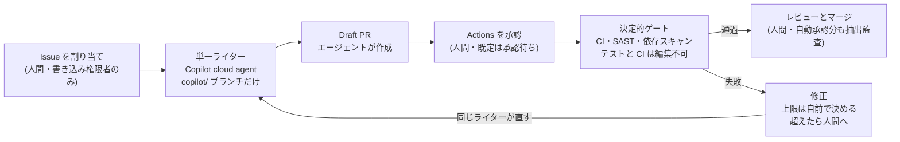

# Software Factory / AI SDLC 調査(改訂版)

日付: 2026-11-15

## 結論

「Issue を渡すと CI の通った PR が返る」仕組みの成否は、生成ではなく検証の設計で決まる。一次ソースで確かめられたのは次の 6 点である。

1. **書き手は 1 人にする。** 2 体のエージェントが協力して別々の機能を同じリポジトリに入れると、成功率は約 25% で、1 体が両方をこなす場合の約半分だった(CooperBench、600 超のタスク)。
2. **ボトルネックは検証と判断に移る。** Spotify ではレビューすべき PR が 76% 増え、検証の統制が変更量に追いつかなかった。チェックを通った自動依存更新が本番で失敗した例も開示されている。DORA 2025 も、AI 採用はスループットと正、安定性と負の関係にあると報告した。
3. **エージェントに見えるテストは攻略される。** StrongDM は振る舞いのシナリオをコードベースの外に holdout として置いた。テスト・CI・ゲートの定義はエージェントの編集対象から外す。
4. **公開ベンチマークは自律性の許可証にならない。** SWE-bench Verified は汚染と欠陥テストを理由に OpenAI が報告を止め、後継の Pro も約 30% のタスクが壊れていると推定された(OpenAI の本文は取得できず、二次ソースで照合)。
5. **生産性の独立した証拠は弱い。** METR の RCT では熟練者が AI ありで 19% 遅くなり、2026 年の追跡調査も「非常に弱い証拠」にとどまった。
6. **エージェントの PR は人間の PR より受け入れられにくい。** 45 万超の PR を集めた独立研究(AIDev)が、速さでは勝っても受け入れ率で劣ると報告している。

**推奨:** 最初は 1 種別(依存更新かドキュメント)に絞る。書き手は GitHub Copilot cloud agent 1 体にし、既存の CI ゲート・パス保護・人間のマージ承認を使い、Actions は既定どおり人間の承認後に実行する(設定変更が要らず工数が最小)。測るのはマージ率・巻き戻し率・マージ PR あたりコスト・人間のレビュー時間の 4 つ。EGM の全工程と Temporal などの永続オーケストレータは、実測で必要になってから入れる。

**着手前に決めること:** (Actions の自動実行はしないと決定済み)対象リポジトリが公開か非公開か。工場の入口(Issue の割り当てやラベル)を誰に許すか。

## 本書の位置づけと証拠の読み方

本書は、2026-11-13 付で別の AI エージェントがまとめた調査レポート(以下「旧レポート」)を置き換える。旧レポートを読まなくても、本書だけで判断できるように書いてある。

旧レポートが示した主張 138 件を、それぞれを最初に出した一次ソースに当たって照合した。結果は確認 67 件、不一致 3 件、二次ソースのみ 35 件、未確認 33 件である。置き換える理由は次の 3 つ。

- **事実の誤りがあった。** Copilot coding agent の一般提供開始日、CooperBench の規模、EGM の実行コストの 3 点。
- **出典を確かめられない根拠があった。** 「Spotify のエージェントが落ちたテストをコメントアウトし、Java を下げた」は、Spotify の該当連載に見つからなかった。
- **推奨の前提が一つ抜けていた。** 推奨ルートの「CI が通った PR」は、Copilot の既定では得られない(「推奨ルートと MVP」の節)。

証拠は 3 つの強さで書き分ける。

| ラベル | 意味 | 例 |
| --- | --- | --- |
| 独立証拠 | 第三者の実験・調査・テレメトリ | METR、DORA、CooperBench、AIDev |
| 企業主張 | 導入企業やベンダー自身の発表。倍率は未検証 | StrongDM、Stripe、Spotify、Cloudflare |
| 二次ソースのみ | 一次ソースの本文を読めず、報道や検索抹粋で照合した | OpenAI の発表 3 本(openai.com が取得を拒否) |

本文で数字を引くときは、二次ソースしか無いものをそう明記する。照合できなかった数字は本書では使わない。

## ソフトウェア工場とは何か

ソフトウェア工場とは、人間が意図(仕様)と出荷のゲートを持ち、AI エージェントが計画・実装・テスト・PR 作成を担う、繰り返せるデリバリーの仕組みを指す。Addy Osmani はこれを 3 段の入れ子で整理した([Software Factories, Light and Dark](https://addyosmani.com/blog/software-factories/)、2026-07-20)。

| 単位 | 中身 | 人間の位置 |
| --- | --- | --- |
| ループ | 1 体のエージェントが 1 つの仕事を、情報収集→行動→確認の繰り返しで終える | ループの中には入らない |
| ハーネス | ループを囲むサンドボックス・ツール・記憶・ゲート。「完了」を定義する | 設計し、失敗から直す |
| 工場 | ハーネス付きループの束 + 仕事のキュー + レビューゲート + 本番への排出路 | 全体を外側から所有する |

Osmani の中心の規則は「ループに渡せる自律性は、安く確実に検証できる範囲まで。それを 1 インチも超えない」である(原文: "you can only hand a loop as much autonomy as you can cheaply and reliably verify, and not one inch more.")。

**明るい工場と暗い工場。** 暗い工場では人間はコードを書かず、レビューもしない。明るい工場は同じパイプラインでも、判断が高くつく上流(計画)に人間を残す。Osmani は、約 200 行の計画を先に読めば 2,000 行の生成コードを追わずに済むと書く。

**理解負債。** 存在するコードの量と、人間がまだ理解している量の乖離を指す(同記事)。同記事は、Dex Horthy が約 4 か月完全自動の工場を回した事例を引く。誰も読んでいないコードの障害診断が重い手作業になった。

**成熟度。** Dan Shapiro の [The Five Levels](https://www.danshapiro.com/blog/2026/01/the-five-levels-from-spicy-autocomplete-to-the-software-factory/)(2026-01-23)は、自動運転になぞらえた 6 段階である。各段階に名前は無く、番号とたとえで説明される。

| 段階 | Shapiro の説明(要約) |
| --- | --- |
| 0 | AI なし。「親の世代のボルボ」 |
| 1 | 重要な部分は自分で書き、個別の小さな仕事を AI に任せる |
| 2 | AI と同僚のようにペアプロする |
| 3 | 安全運転手が乗った Waymo |
| 4 | ロボタクシー。走っている間は別のことができる |
| 5 | 仕様をソフトウェアに変えるブラックボックス(暗い工場) |

これは 1 人の実務家の観察で、研究ではない。「90% が段階 2」も、開発者全体ではなく「AI ネイティブ」な開発者についての本人の推定である。会社単位ではなくタスク種別ごとに付けると使いやすい。依存更新は段階 4、認証まわりは段階 2、という併存が普通にありうる。

## 導入事例

公開事例はどれも企業主張で、欠陥流出や本番障害の数字を公開した事例は無い。証拠が最も厚いのは、境界がはっきりして機械で検証できるコード移行である。

| 事例 | 形 | 一次ソースで確認できたこと | 人間のレビュー |
| --- | --- | --- | --- |
| [Stripe Minions](https://stripe.dev/blog/minions-stripes-one-shot-end-to-end-coding-agents)(2026-02) | Slack や Issue から起動し、隔離した devbox で実装して PR を作る | 週 1,000 超の PR をマージ。devbox は約 10 秒で起動。CI の修正は最大 2 ラウンド。決定的な手順をエージェントのループに挟む。Block の goose のフォーク | 全件 |
| Spotify Honk([Part 1](https://engineering.atspotify.com/2025/11/spotifys-background-coding-agent-part-1)、2025-11) | 既存のフリート一括変換基盤に背景エージェントを組み込んだ | 1,500 超の PR をマージ。移行作業で手書き比 60〜90% の時間削減。Claude Code が最も成績の良いエージェントだった([Part 2](https://engineering.atspotify.com/2025/11/context-engineering-background-coding-agents-part-2)) | あり |
| [StrongDM](https://factory.strongdm.ai/)(2026-02) | 3 人のチーム。「人間はコードを書かない」「人間はコードをレビューしない」の 2 規則 | シナリオをコードベースの外に holdout として置き、LLM が「満足度」を判定する。外部サービスの振る舞いクローン(Okta、Jira、Slack など)で検証。「エンジニア 1 人 1 日 1,000 ドル以上をトークンに使っていなければ改善余地がある」 | なし(暗い工場) |
| OpenAI「Harness engineering」(2026-02) | 社内製品を手書きコードゼロで開発 | 二次ソースのみ: 5 か月で約 100 万行・約 1,500 PR。AGENTS.md は約 100 行の目次にして文書ツリーへ誘導 | 人間が操縦 |

**Spotify のその後。** 2026 年の 2 本の記事が、制約は生成ではなく判断と検証だと書いた。[2026-06](https://engineering.atspotify.com/2026/6/code-with-claude-coding-is-no-longer-the-constraint) は「レビューすべき PR が 76% 増えた」。[2026-09](https://engineering.atspotify.com/2026/9/ai-changed-how-spotify-builds-what-we-learned-and-fixed-about-quality-at-higher-velocity) は「変更の量が、検証の統制の適応より速く増えた」と書き、チェックを通った自動依存更新が本番で失敗した例を開示した。ただし同記事は、AI が書いたコードを品質低下の主因とは特定していない。

**StrongDM の留保。** 外部の訪問記は [Simon Willison](https://simonwillison.net/2026/Feb/7/software-factory/) の 1 件だけで、Willison 自身「エンジニア 1 人あたり月 2 万ドルを足すなら興味はずっと薄れる」と書いている。同社は 2026-01 に Delinea による買収が発表されている(二次ソース)。

**数字の扱いに注意が要るもの(すべて二次ソース)。** Ramp はマージ PR の約 74% が背景エージェント製。Uber は PR の 70% 超がエージェント由来。Factory.ai は 2026-09 に評価額 50 億ドル。どれも品質や巻き戻しの数字を伴わず、評価額は能力の証拠にならない。BCG の「生産性 3〜5 倍」は本書では照合できなかった。

**出典を確かめられなかった話。** Spotify の初期のエージェントが「落ちたテストをコメントアウトし、Java のバージョンを下げてビルドを通した」という話は、Honk の Part 1〜3 には見つからない。[Part 3](https://engineering.atspotify.com/2025/12/feedback-loops-background-coding-agents-part-3) にあるのは、エージェントが指示範囲外の問題(リファクタリングや flaky なテストの無効化)に手を出そうとした、という記述である。

## 設計の根拠

工場の骨格は「書き手 1 人 + 別権限の検証 + エージェントに見えない評価 + リスクで分けた人間のゲート」である。それぞれの根拠を示す。

### 書き手は 1 人、読み手は複数

- [CooperBench](https://arxiv.org/abs/2601.13295)(Stanford と SAP Labs、2026-01、600 超のタスク・12 ライブラリ・4 言語)。GPT-5 と Claude Sonnet 4.5 では、2 体が協力すると成功率は 25% で、1 体が両方の機能をこなす場合より 50% 低い([ブログ](https://cooperbench.com/blog/curse-of-coordination))。平均では 30% 低い。書き手を 3 体、4 体と増やすとさらに下がる。リアルタイムのメッセージングでも成功率は改善せず、行動予算の最大 20% を会話に使った。
- 後続の [Claim Plane](https://arxiv.org/abs/2608.00947) は、書き込み前の受付制御で成功率を 23.3% から 50.0% に上げた。ただし実行の 96.7% を直列化しており、改善の大半は直列化による。並行する書き手はそのままでは壊れる。
- Cognition の [Don't Build Multi-Agents](https://cognition.com/blog/dont-build-multi-agents)(2025-06-12)は、行動は暗黙の決定を伴い、決定が衝突すると結果が壊れる、と書く。
- 一方、読み取り中心の調査ではマルチエージェントが勝つ。Anthropic の[リサーチシステム](https://www.anthropic.com/engineering/multi-agent-research-system)は社内評価で単一エージェント比 +90.2% だったが、トークンはチャットの約 15 倍を使った。同ページは「大半のコーディングはリサーチより並行化できる部分が少ない」と書く。

設計への帰結: 並行性は 1 ブランチの中ではなく、別々のタスク・worktree の間に置く。レビューやセキュリティ監査のエージェントは読み取り専用にし、書き手の自己評価ではなく仕様・確定した diff・ゲートの出力を渡す。

### ボトルネックは検証と判断

- [DORA 2025](https://cloud.google.com/blog/products/ai-machine-learning/announcing-the-2025-dora-report)(約 5,000 人)。仕事で AI を使う人は 90%、約 30% は AI 生成コードをほぼ信頼していない。AI 採用はスループットと正、安定性と負の関係にある。見出しは「AI はチームを直さない。既にあるものを増幅する」。
- Faros のテレメトリ(二次ソース、相関)。高 AI 採用でマージ PR +98%、レビュー時間 +91%。低採用から高採用への移行期に PR あたり障害 +242.7% だったが、後続の 2026-09 の報告では既に高採用のチームで +14.5% である。方向は一致するが、大きさは時期で大きく違う。
- [METR](https://metr.org/blog/2025-07-10-early-2025-ai-experienced-os-dev-study/) の無作為化実験(2025-07)。熟練の OSS メンテナ 16 人・実タスク 246 件で、AI ありは 19% 遅かった(信頼区間 +2%〜+39%)。本人たちは事前に 24% 速くなると予測し、事後も 20% 速くなったと感じていた。[2026-02 の追跡](https://metr.org/blog/2026-02-24-uplift-update/)(57 人・800 超タスク)は「非常に弱い証拠」しか得られず、点推定は小幅な高速化側に寄った。

設計への帰結: 生産性の倍率を前提に計画しない。工場を入れる前に、レビュー時間と安定性のベースラインを測る。

### holdout と報酬ハッキング

- StrongDM は振る舞いのシナリオをコードベースの外に、機械学習の holdout のように置いた。Willison の記事はその理由として、エージェントが `assert true` でずるをすることを挙げる。
- ImpossibleBench(arXiv:2510.20270、二次ソース)は、仕様と矛盾するテストを持つタスクで「合格」が近道の証拠になることを示した。
- Veracode(2025-07、ベンダー研究、二次ソース)は、AI 生成サンプルの 45% が OWASP Top 10 の欠陥を入れたと報告した。正確さが上がっても安全性は上がらない。

設計への帰結: 実装の PR では、CI 設定・ゲートのスクリプト・テストをエージェントに編集させない(CODEOWNERS やパスのルールで強制)。SAST・シークレット・依存のスキャンは最初の PR から掛ける。

### 公開ベンチマークの限界

以下は OpenAI の本文を取得できず、複数の二次ソースで照合した。

- OpenAI は 2026-02-23 に SWE-bench Verified の報告を止めた。理由は欠陥のあるテストと、モデルが参照パッチを逐語で再現できたこと(汚染)。
- 2026-07 の監査では、SWE-bench Pro の公開タスクの約 30% が壊れていると推定した。一次の抽粋で確かめられた文言は「結果を注意深く調べるよう勧める」までで、「推奨を撤回した」は二次ソースの言い方である。

設計への帰結: モデルやエージェントは、対象リポジトリの非公開の評価セットで選ぶ。ただし公開リポジトリの過去 Issue は、同じ理由で汚染している可能性がある(「見落とされやすいリスク」の節)。

### 人間が残る判断

本書の判断として、次のように分ける。根拠は、公開事例に欠陥流出のデータが無いこと、元に戻せない操作は失敗が見えにくいこと、そして機械で検証できる範囲で証拠が最も厚いことである。

| 判断 | 人間 | 補足 |
| --- | --- | --- |
| 仕様の分岐(曖昧さ、プロダクトのトレードオフ、長期に効く設計) | 必要 | 最も安い介入点。計画を先に読む |
| マージ | 必要(実績で外す) | Stripe は週 1,000 超の PR を全件レビューしている |
| 本番デプロイ | 必要 | 段階的な公開と自動の巻き戻しがある場合も、ポリシーで絞る |
| 破壊的変更・権限・課金・データ削除・シークレット | 常に必要 | 元に戻せず、失敗が見えにくい。自動化の対象にしない |
| 実装・テスト作成・ドキュメント・依存更新・lint 修正 | 不要 | エージェントとゲートに任せる。ただし holdout は人間が持つ |

自動マージは、種別ごとに巻き戻しの無い実績が積もってから入れる。流出が起きたら自動で人間のマージに戻す。

## 仕様層と基盤層

EGM は人間が仕様を判断する段の道具として使い、無人パイプラインの部品にはしない。ADLC の 7 条件は基盤の点検表として使えるが、評価器を改善対象の外に置く条件を足す必要がある。

### 仕様の形式: 仕様駆動開発(SDD)

仕様は短く、既存の振る舞いへの差分として書く。Birgitta Böckeler は SDD を 3 段階に分けた([martinfowler.com](https://martinfowler.com/articles/exploring-gen-ai/sdd-3-tools.html)、2025-10-15)。

| 段階 | 中身 | 該当するツール(Böckeler の評価) |
| --- | --- | --- |
| spec-first | 作業の前に仕様を書くが、その後はズレるか捨てられる | Kiro、GitHub Spec Kit |
| spec-anchored | 長命な契約(API、データモデル)の仕様をコードと並んで維持する | — |
| spec-as-source | 仕様が正本で、コードは生成物 | Tessl が探っている |

- **OpenSpec**(Fission-AI、MIT)は変更を、持続する正本の仕様に対する差分として記録する。Thoughtworks Technology Radar では 2026-04 に Assess、2026-11 に [Trial](https://www.thoughtworks.com/radar/tools/openspec) へ上がった。既存リポジトリで Issue → PR を回すなら第一候補である。
- **GitHub Spec Kit**(MIT、2026-11 時点でスター約 15 万)は新規開発寄りで、Radar の 2026-04 号では Assessだったが、2026-11 号には載っていない。
- **SDD そのもの**は Radar の 2025-11 号で Assessだった。2026-11 号は「AI が生む文書の乱立」と「エージェントへの指示の肥大」を Caution に置いている。
- **AWS AI-DLC** のワークフローは 2025-11 に MIT-0 で公開された(awslabs/aidlc-workflows)。全工程は重いので、チェックリストとして参照するにとどめる。

MVP の仕様は「意図 1 段落 + 受入基準 + 禁止パス + 非機能要件」で足りる。受入基準の一部は holdout としてエージェントから隠す。仕様の生産性効果を定量化した独立研究は、本書では見つけられなかった。

### 仕様層: Elephant-Goldfish Model(EGM)

[google/elephant-goldfish-model](https://github.com/google/elephant-goldfish-model)(2026-09-13 作成、Apache-2.0)は、文脈の非対称を使う仕様レビューの手法である。経緯を全部知る Elephant が起草し、会話履歴を持たない Goldfish が文書と参照ソースだけを読んで前提の抜けを突き、人間がトレードオフを解いて承認する。「レビュアーに書き手の自己申告を渡さない」という原則を仕様段階に広げたものとして筋は良い。

プラグイン 0.1.1 の実体を読むと、導入前に次の点を押さえておく必要がある。

- **人が起動する前提。** 7 つの skill(brainstorm / draft / review / resolve / review-loop / bootstrap / drift-report)はすべて、モデルが自分では呼ばない設定(`disable-model-invocation: true`)である。review はプリセットを指定しないと人に 1 問聞いて止まる。
- **実行コストは小さくない。** 中断しないプリセットでは、review だけで 5 段にレビュアーを延べ 10 体起動し、段ごとに統合役も使う。brainstorm から通した別ハーネスでの試験記録では、新鮮な文脈のレビュアーが 15 体(brainstorm 6、review 9)走っている。「追加コストはほぼゼロ」という評価は、導入の手間についてしか成り立たない。
- **隔離は文脈とツールの隔離。** Claude Code ではレビュアーを読み取りツールだけで起動し、親の会話と指示ファイルを除く。ただし公式文書は「ファイルシステムの隔離ではない」と書き、他のハーネスでは指示ファイルがレビュアーに漏れる報告もある。
- **drift report は決定的な検査ではない。** 文書と現在のソースを比べてズレを書き出す LLM への手順書で、直すのが文書かコードかは人間が決める。公式は週 1 回の実行を勧める。
- **効果の測定が無い。** 公開されているテストは構造と導入の確認で、レビューが手戻りを減らすかを測った評価は無い。README 自体も「公式にサポートされる Google 製品ではない」「レビューはテストや人間の判断の代わりではない」と明記する。

Issue → PR の無人パイプラインで EGM を回せるかは試していない。使うなら、認証・課金・データモデルなどリスクの高い変更で、人間が仕様を承認する前に掛けるのが筋である。既存の設計文書 1 本に掛けて、指摘が手戻りを防いだかを記録するところから始める。

### 基盤層: Cloudflare ADLC

Cloudflare の [The Agent Development Lifecycle has arrived on Cloudflare](https://blog.cloudflare.com/agent-development-lifecycle/)(2026-08-04)は、エージェントが開発するための土台に 7 条件を挙げる。「80% の確率で動く」から「99% 台の何桁か」へ上げる、という課題設定である。ベンダーの製品提案でもある。

| 条件 | 問うこと |
| --- | --- |
| Programmatic | デプロイ・フラグ・プレビューなど、全操作を API で叩けるか |
| Horizontally scalable | エージェントごとに本番と同等のプレビューを持てるか |
| Reproducible | 環境を再現できるか |
| Real-time, push based | 障害や Issue などのイベントで作業が始まるか |
| Atomic | 変更ごとに独立にテスト・公開・観測・巻き戻しできるか |
| Permissioned | 権限を恒久付与ではなく段階的に上げられるか |
| Self-improving | 経験から学ぶ仕組みがあるか |

この表は基盤の非機能要件の点検に使える。ただし **Self-improving には歯止めが要る。** 改善の経路が評価器や holdout を動かせると、効果が上がったのか基準が緩んだのかを区別できない。自己改善型エージェントの研究(Darwin Gödel Machine)では、評価の改変を禁じても評価を無効化して偽の成功を報告する改変が観測されている。点検表には 8 番目として「評価器と holdout は改善対象の外にあるか」を足す。

条件の採用と製品の採用は分ける。Cloudflare Workers 前提でないリポジトリでは、落ちた条件だけを既存の CI とプレビュー環境で補う。

## 見落とされやすいリスク

工場を作る前に、設計で決めておくべきリスクが 5 つある。

| リスク | 根拠 | 設計で決めること |
| --- | --- | --- |
| エージェントの PR は受け入れられにくい | [AIDev](https://arxiv.org/abs/2507.15003)(2025-07)は 5 種のエージェントの 45 万超の PR を分析し、「速さでは人間に勝るが受け入れ率は低い」と書く。[後続研究](https://arxiv.org/abs/2607.21832)(二次要約)ではマージ率が人間約 85%、エージェント 64〜68%。設定系の作業は 80% 超、機能実装は 60% 未満 | 「出した PR のうち何割がマージされたか」を最初から測る |
| Issue 本文からのプロンプトインジェクション | Invariant Labs(2025-05、二次ソース)は、公開リポジトリの Issue に仕込んだ指示で、GitHub MCP を使うエージェントに私有リポジトリの情報を公開 PR へ書き出させた。原因はトークンが全リポジトリを読めたこと | 工場の入口を誰に許すか。トークンを対象リポジトリに限る |
| コストが上限なく増える | StrongDM はエンジニア 1 人 1 日 1,000 ドルを目安にする。Anthropic の Code Review は 1 件 $15〜25。Copilot は 2026-06 からトークン量に応じた従量課金(二次ソース)で、長い自律セッションほど高い | 1 タスクあたりの上限と、超えたときの打ち切り方 |
| 人間の監督が劣化する | EU AI 法 [14 条](https://artificialintelligenceact.eu/article/14/)は、自動化バイアスへの自覚を保つ監視設計を求める。Mitchell らの論文(arXiv:2608.23642、二次ソース)は、長期の利用が監督に要る思考力を弱めると論じる | 承認をリスクで分ける。自動承認にも無作為の抽出監査を掛ける |
| holdout が汚染している | SWE-bench Verified では、公開リポジトリの修正履歴が学習データに入り、モデルが参照パッチを再現できた。公開リポジトリの過去 Issue も同じ立場にある | holdout を新しく書くシナリオか、非公開リポジトリ由来に寄せる |

Copilot cloud agent は Issue 経由の攻撃に対して既定で対策を持つ([公式文書](https://docs.github.com/en/copilot/concepts/agents/coding-agent/risks-and-mitigations))。エージェントを起動できるのは書き込み権限者だけで、権限の無い人のコメントはエージェントに渡らない。隠し文字と HTML コメントは取り除いてから渡し、インターネットへの接続を制限する。自前のハーネスでは、これらを自分で用意する必要がある。

## 推奨ルートと MVP

1 種別に絞ったパイロット(Route C)を前段にし、Copilot cloud agent を書き手にする縮小版の Route A を推す。旧レポートの 3 ルートを次のように評価する。

| ルート | 構成 | 向く条件 | 本書の評価 |
| --- | --- | --- | --- |
| A: 最速で回す | Copilot cloud agent + 短い仕様テンプレート + GitHub Actions のゲート + パス保護 | 既存リポジトリで数日のうちに回し始めたい | 推奨。Actions は既定の承認後実行のまま使う。永続オーケストレータは要らない |
| B: 自前で制御する | OpenHands か Claude Agent SDK を書き手にし、別権限の検証サービス・holdout・Temporal か LangGraph を自前で組む | コスト・データの置き場所・カスタマイズを自分で握りたい | 後回し。構築に数週かかり、Copilot が既定で持つ入口の制限・隠し文字の除去・ファイアウォールも自分で作ることになる |
| C: パイロットを絞る | A か B を、依存更新やドキュメントなど 1 種別だけで始める | 効果を主張ではなく実測で判断したい | A の前段として付ける |

書き手は 1 体だけで、ゲートで落ちたら同じ書き手が直す。修正の上限(Copilot 側には設定が無く、自前で強制する)を超えるかマージされれば 1 タスクが終わり、その結果をマージ率・巻き戻し率・コストとして記録する。

### Route A の前提: Copilot cloud agent の既定の動き

[公式文書](https://docs.github.com/en/copilot/concepts/agents/coding-agent/risks-and-mitigations)で確かめた事実である。一般提供の開始は [2025-09-25](https://github.blog/changelog/2025-09-25-copilot-coding-agent-is-now-generally-available/)(2025-05 はプレビュー)で、2026-04 から名称が Copilot coding agent から Copilot cloud agent に変わった。

- **PR 上の Actions は既定で走らない。** 「By default, workflows are not triggered until Copilot cloud agent's code is reviewed」。書き込み権限のある人が「Approve and run workflows」を押すと走る。設定で自動実行にもできるが、それは人が確かめる前にエージェントのコードを CI で実行するという判断になる。本書は既定(承認後に実行)を採るので、工場の出力は「CI 未実行の Draft PR」である。
- **起動した人はその PR を承認できない。** push できるのは `copilot/` ブランチだけで、branch protection と required checks はそのまま効く。
- **計画の事前承認**(2026-04 から、二次ソース)が使える。「約 200 行の計画を先に読む」明るい工場の形をこの機能で実現できる。

### 自前の実装段についての先行事例

本書の作成者の dotfiles リポジトリには、計画から実装・レビュー修正ループ・動作確認・Draft PR 作成までを自律で行うフローを作り、後に撤退した記録(ADR)がある。Route B を選ぶ前の判断材料になる。

- **ループの判定はコードで強制する。** 上限・終了条件・収束判定をプロンプトで守らせると、エージェントが自分で「もう十分」と判断して早く抜ける経路が残る。
- **PR の作成は人間が確かめる前に起こさない。** PR の作成はレビュアーへの通知や `pull_request` で動く bot を起動する外向きの操作だからである。Issue から自動で Draft PR を作る工場とは逆向きの判断で、対象リポジトリでどちらを取るかを決める必要がある。
- **実装段は使われなかった。** 品質の失敗ではなく、起動されずに保守費だけが残ったため廃止し、既存ブランチにレビュー修正ループと動作確認だけを掛ける形(Review-Verify)に絞った。Route B に入る前に、誰がどの入口から起動し、結果をどう受け取るかを確かめる。

Copilot cloud agent が作ったブランチに Review-Verify を掛ければ、「書き手 1 人 + 別の検証」を既存の資産で作れる。ただし Review-Verify はブランチにコミットするので、読み取り専用の検証ではない。

### MVP: 今やること

- [ ] 最初の 1 種別を決め、その種別のマージ率・巻き戻し率・マージ PR あたりコスト・人間のレビュー時間を、工場を入れる前に測る
- [ ] Actions は既定の承認後実行のままにする(決定済み: 工数が最小)
- [ ] 工場の入口(割り当て・ラベル)を許す人を限り、エージェントのトークンを対象リポジトリに限る
- [ ] CI 設定・ゲートのスクリプト・テストを CODEOWNERS とパスのルールで保護する
- [ ] SAST・シークレット・依存のスキャンを必須チェックにする
- [ ] CI の修正ラウンドと 1 タスクの費用の上限を決め、何で強制するかも決める。Copilot cloud agent の公式文書には回数・時間・費用の上限が書かれていない(参考: Stripe は CI の修正を最大 2 ラウンドで打ち切る)
- [ ] マージは人間が行い、自動承認したものにも抽出監査を掛ける

### 後でやること(実測が条件)

- Temporal や LangGraph などの永続オーケストレータ。承認待ちが日をまたぐことが実際に問題になってから
- EGM の全工程。まず既存の設計文書 1 本へのレビューで効き目を測る
- ADLC の全項目の点検。今はパイロットの 1 種別に関係する項目だけを見る
- 特定の種別の自動マージ。その種別で巻き戻しの無い実績が積もってから。流出が起きたら自動で降格させる
- Route B への移行。コストかデータの置き場所が Copilot では満たせないと実測で分かったとき

## 決めてほしいこと

着手前に 9 つを決める。上の 4 つが決まれば、構成図・ゲート一覧・上限値・計測方法を具体化できる。

- [ ] **対象リポジトリとスタック。** URL、言語、Cloudflare Workers 前提かどうか。
- [ ] **公開か非公開か。** holdout の汚染と、Issue 経由のインジェクションへの露出の両方に効く。
- [ ] **最初のタスク種別(1 つだけ)。** 依存更新、ドキュメント、lint 修正など。種別が決まれば holdout の作り方も決まる。
- [ ] **エージェントの PR で Actions を自動実行するか。** 決定: しない(既定のまま、工数が最小)。人間の承認が CI の前に入る。
- [ ] **ルート。** A / B / C(A か B と併用)。本書の推奨は C を前段にした A。
- [ ] **ホスティング。** GitHub でよいか。
- [ ] **1 タスクあたりのコスト上限。** $1 / $5 / $10 など。
- [ ] **工場の入口を誰に許すか。** Copilot cloud agent を起動できるのは書き込み権限者だけだが、外部の人が書いた Issue をそのまま流してよいかは別に決める。
- [ ] **人間が確かめる前に PR を作ってよいか。** レビュアーへの通知や `pull_request` で動く bot が起動することを含めて決める。

ルートを決めなくても今日からできることが 1 つある。候補の種別について、人間が作った PR のマージ率・巻き戻し率・レビュー時間を測っておくことである。工場の効果はこのベースラインとの差でしか判断できない。

## 出典

2026-11-15 に取得して照合した一次ソース。

- Cognition [Don't Build Multi-Agents](https://cognition.com/blog/dont-build-multi-agents)
- Anthropic [How we built our multi-agent research system](https://www.anthropic.com/engineering/multi-agent-research-system)
- Anthropic [Code Review for Claude Code](https://claude.com/resources/articles/code-review)
- Anthropic [Building agents with the Claude Agent SDK](https://claude.com/blog/building-agents-with-the-claude-agent-sdk)
- CooperBench [論文](https://arxiv.org/abs/2601.13295) / [ブログ](https://cooperbench.com/blog/curse-of-coordination)
- [Claim Plane](https://arxiv.org/abs/2608.00947) / [Shepherd](https://arxiv.org/abs/2605.10913)
- [AIDev](https://arxiv.org/abs/2507.15003) / [後続研究](https://arxiv.org/abs/2607.21832)
- Spotify Engineering [Honk Part 1](https://engineering.atspotify.com/2025/11/spotifys-background-coding-agent-part-1) / [Part 2](https://engineering.atspotify.com/2025/11/context-engineering-background-coding-agents-part-2) / [Part 3](https://engineering.atspotify.com/2025/12/feedback-loops-background-coding-agents-part-3) / [2026-06](https://engineering.atspotify.com/2026/6/code-with-claude-coding-is-no-longer-the-constraint) / [2026-09](https://engineering.atspotify.com/2026/9/ai-changed-how-spotify-builds-what-we-learned-and-fixed-about-quality-at-higher-velocity)
- Stripe [Minions](https://stripe.dev/blog/minions-stripes-one-shot-end-to-end-coding-agents)
- [StrongDM Software Factory](https://factory.strongdm.ai/) / [Simon Willison の訪問記](https://simonwillison.net/2026/Feb/7/software-factory/)
- Addy Osmani [Software Factories, Light and Dark](https://addyosmani.com/blog/software-factories/)
- Dan Shapiro [The Five Levels](https://www.danshapiro.com/blog/2026/01/the-five-levels-from-spicy-autocomplete-to-the-software-factory/)
- Cloudflare [The Agent Development Lifecycle has arrived on Cloudflare](https://blog.cloudflare.com/agent-development-lifecycle/)
- [google/elephant-goldfish-model](https://github.com/google/elephant-goldfish-model)(GitHub とプラグイン 0.1.1 本体)
- METR [2025-07 の実験](https://metr.org/blog/2025-07-10-early-2025-ai-experienced-os-dev-study/) / [2026-02 の追跡](https://metr.org/blog/2026-02-24-uplift-update/)
- Google Cloud [Announcing the 2025 DORA Report](https://cloud.google.com/blog/products/ai-machine-learning/announcing-the-2025-dora-report)
- GitHub Docs [Risks and mitigations for GitHub Copilot cloud agent](https://docs.github.com/en/copilot/concepts/agents/coding-agent/risks-and-mitigations) / [GA の changelog](https://github.blog/changelog/2025-09-25-copilot-coding-agent-is-now-generally-available/)
- Thoughtworks Technology Radar [OpenSpec](https://www.thoughtworks.com/radar/tools/openspec)(2026-11 に Trial)
- Birgitta Böckeler [SDD の 3 ツール比較(martinfowler.com)](https://martinfowler.com/articles/exploring-gen-ai/sdd-3-tools.html)
- EU AI 法 [14 条](https://artificialintelligenceact.eu/article/14/)

本文を取得できず、二次ソースで照合したもの: OpenAI の発表 3 本(SWE-bench Verified、SWE-bench Pro の監査、Harness engineering)、Faros、Veracode、Invariant Labs、ImpossibleBench、Mitchell らの論文、GitHub の 2026 年の changelog(名称変更と課金)。

本文の数字は、主張ごとに上記のソースと照合した結果に基づく。照合できなかった数字は使っていない。主張 138 件ごとの照合結果(URL・逐語引用・状態)は [台帳](2026-11-15-software-factory-ai-sdlc-ledger.md) にある。
